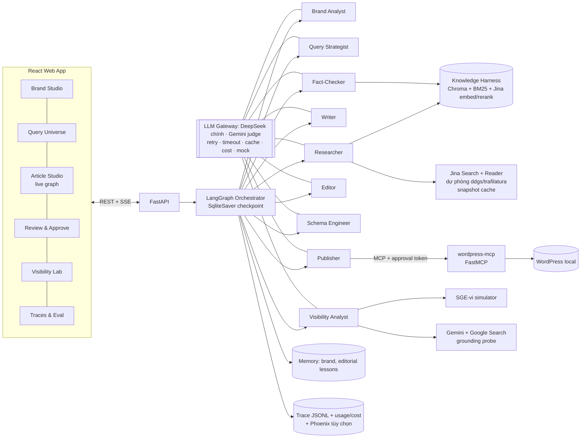
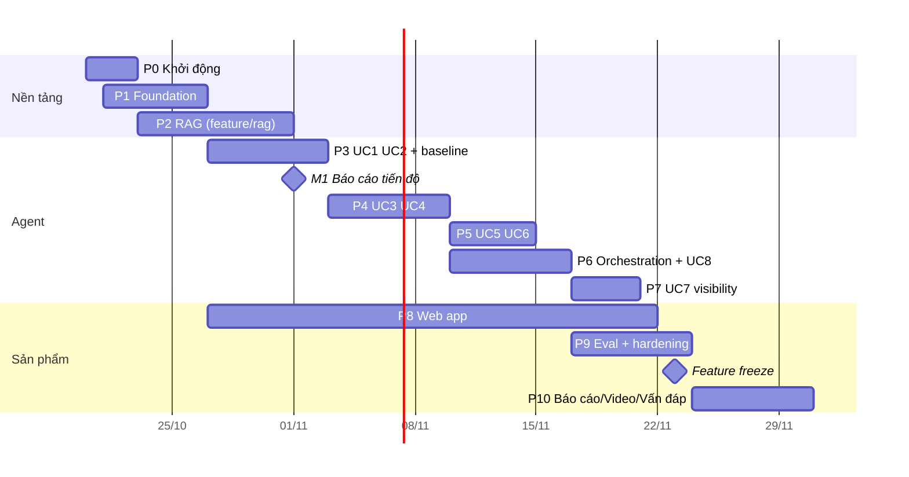

# KẾ HOẠCH ĐỒ ÁN CUỐI KỲ SE373: VietCite Studio

### Hệ thống đa tác tử viết nội dung tiếng Việt chuẩn GEO, có kiểm chứng, có đo lường và chỉ xuất bản khi người duyệt

> **Môn:** SE373, Kỹ thuật xây dựng hệ thống Agentic AI (UIT)
> **Nhóm đề tài:** #4, GEO content writer Agent (TA phụ trách: DNPNam)
> **Miền demo:** SaaS quản lý bán hàng và hoá đơn điện tử cho hộ kinh doanh (thương hiệu giả lập "Tallyo", đối thủ thật). Chốt ngày 20/10/2026, thay cho phương án UIT tuyển sinh. Ngày 24/10/2026 đổi tên thương hiệu từ "SổBán" sang **"Tallyo"** (tên tiếng Anh, không dấu; tra nhanh trên web chưa thấy sản phẩm trùng tên).
> **Ngày lập:** 20/10/2026 · **Cập nhật:** 24/10/2026 (tích hợp kiến thức Buổi 7, xem mục 4.7) · **Hạn dự kiến:** nộp và vấn đáp khoảng 24–30/11/2026 (khoảng 5 tuần)
> **Thư mục làm việc chính thức:** `D:\UIT hoc ki 5\SE373 - AI agentic\Do An`
> **Vị trí:** `Do An\docs\KE_HOACH_DO_AN.md` trong repo [VietCite_SE373](https://github.com/DungTruong1610/VietCite_SE373).

---

## 0. Bối cảnh

**Vì sao có kế hoạch này.** Đồ án chiếm 50% điểm môn, chấm trên thang 10 qua ba vòng: checklist repo → video demo → vấn đáp. Đề tài đã chọn là *GEO content writer Agent*: agent viết bài tiếng Việt tối ưu để được ChatGPT, Gemini, Perplexity… trích dẫn. Agent phải làm đủ chuỗi việc: phân tích thương hiệu, sinh tập câu hỏi người dùng hay hỏi AI, nghiên cứu nguồn, viết theo giọng thương hiệu, kiểm chứng số liệu, biên tập, sinh schema markup, đo mức độ được AI nhắc tới trước và sau khi có bài, rồi xuất bản lên WordPress sau khi người duyệt.

**Barem chấm (ảnh 2):**

| Phần            | Điểm      | Cách chấm                                                                                                                                                                                                                       |
| ---------------- | ----------- | --------------------------------------------------------------------------------------------------------------------------------------------------------------------------------------------------------------------------------- |
| Agent            | 7,5         | Mỗi use case 1,5đ = Chức năng 0,5 (chạy đúng tiêu chí) + Thiết kế harness 0,5 (đúng kỹ thuật) + Kiểm chứng 0,5 (eval, trace). Năm use case trọn điểm là đủ 7,5; làm thêm để bù use case chưa trọn. |
| Phần mềm       | 2,5         | Sáng tạo 0,5 · Độ phức tạp kỹ thuật 0,75 · Độ hoàn thiện 0,75 · Khối lượng 0,5. Dạng desktop, web hoặc CLI, phải tích hợp agent thật.                                                                     |
| Phủ kiến thức | trừ điểm | Các use case nộp phải phủ đủ K1–K8; thiếu mỗi mảng trừ 0,5.                                                                                                                                                            |
| Cá nhân        | hệ số     | Điểm nhóm × hệ số vấn đáp (0–1,0) của từng người.                                                                                                                                                                   |
| Vi phạm         | trừ điểm | Lộ API key trừ 1,0. Sao chép hoặc gian lận thì đồ án 0 điểm.                                                                                                                                                           |

**Ràng buộc đã chốt với bạn:**

1. Chưa có danh sách K1–K8 chính thức, nên dùng bản suy luận ở mục 3.2 (xếp theo lộ trình 11 buổi). Khi có bản chính thức thì chỉ cần sửa ma trận.
2. Còn khoảng 5 tuần, nhóm 5 sinh viên.
3. Phần mềm làm dạng **web: FastAPI (Python) + React**.
4. **API có sẵn:**
   - **DeepSeek** là LLM chính (viết, trích xuất, agent).
   - **Jina AI** lo embedding (`jina-embeddings-v3`), rerank (`jina-reranker-v2-base-multilingual`), đọc trang (Reader `r.jina.ai`) và web search (`s.jina.ai`).
   - **Gemini (tuỳ chọn, nên có):** probe trực tiếp Gemini với **Google Search grounding** (một engine AI thật, trả về nguồn trích dẫn), judge khác họ model với DeepSeek để giảm thiên lệch tự chấm, và một model embedding thứ hai cho ablation.
   - Không có API của ChatGPT và Perplexity. Hai engine này đo bằng bộ probe thủ công. Phần đo "trước/sau" dựa trên **Generative Engine giả lập SGE-vi** (mục 2.3), được đối chiếu với Gemini grounded.
   - Mọi chỗ gọi API đều nằm sau một interface có bản dự phòng (local hoặc miễn phí), nên thiếu Gemini thì hệ thống vẫn chạy đủ.

**Kết quả mong muốn:** một hệ thống chạy thật, đủ 8 use case (6 bắt buộc, 2 dự phòng), mỗi use case có tiêu chí chức năng, thiết kế harness và bộ eval kèm trace, phủ K1–K8 với độ dư, và một web app hoàn chỉnh để ăn trọn 2,5 điểm phần mềm.

---

## 1. Tóm tắt môn học: những gì phải thể hiện

### 1.1. Nội dung đã học (đọc từ slide B1, B2, B3, B4, B6, B7 và bài làm B1–B4)

| Buổi | Chủ đề                                   | Kiến thức cốt lõi phải thể hiện trong đồ án                                                                                                                                                                                                                                                                                                                                                                                                                                                                                                                                                                                                                                                                                                                                                                              | Bài làm của bạn (dùng lại được)                                                                                                                                                                                                      |
| ----- | ------------------------------------------- | ---------------------------------------------------------------------------------------------------------------------------------------------------------------------------------------------------------------------------------------------------------------------------------------------------------------------------------------------------------------------------------------------------------------------------------------------------------------------------------------------------------------------------------------------------------------------------------------------------------------------------------------------------------------------------------------------------------------------------------------------------------------------------------------------------------------------------------- | --------------------------------------------------------------------------------------------------------------------------------------------------------------------------------------------------------------------------------------------- |
| B1    | Tổng quan LLM & Agentic AI                 | Bốn nấc completion → chat → tool use → agent. **Ba tiêu chí phân loại: ai quyết bước tiếp, ai giữ state, ai dừng vòng lặp** (bắt buộc trả lời khi vấn đáp). Agent = Model + Harness, 12 lớp harness. Ưu tiên workflow, chỉ dùng agent khi không định sẵn được các bước (agent ≈ 4× token, multi-agent ≈ 15×). Quy tắc dùng AI: minh bạch, kiểm chứng, giải thích được.                                                                                                                                                                                                                                                                                                                                                                                                  | BTVN-01: phân tích Antigravity, lớp context và verification                                                                                                                                                                               |
| B2    | LLM-powered app                             | Token, context window, lost-in-the-middle, context rot, chi phí nhiều bước, prompt caching. Prompt và context engineering, few-shot, CoT, prompt template. **Structured output** (Pydantic, enum, `additionalProperties:false`, trạng thái "insufficient_data"). **Function calling**: model đề xuất, application thực thi và validate.                                                                                                                                                                                                                                                                                                                                                                                                                                                                  | Issue Triage: `IssueTriage` Pydantic, application guard, trace 4 bước, ước tính chi phí bằng tiktoken                                                                                                                                |
| B3    | Agent fundamentals                          | agent = goal + tools + loop + termination. ReAct, Plan-then-execute, Lai, Reflection (kèm bảng chọn mẫu). **5 điều kiện dừng**: đạt mục tiêu, hết ngân sách, phát hiện lặp, bế tắc, cần con người. Tiêu chí hoàn thành bằng code. Sensor computational và inferential. Bốn failure mode: lặp không tiến, bịa, quên yêu cầu, tin dữ liệu sai. Quy trình debug 4 bước. Handoff.                                                                                                                                                                                                                                                                                                                                                                                                      | Agent đặt vé: harness đầy đủ (`core`, `permission`, `completion`, `loop_detector`, `budget`, `grounding`, `contract`, `handoff`, `middleware`), 3 mẫu suy luận, 12 kịch bản × 4 biến thể, 153 test, dashboard |
| B4    | Prompt → Reusable Skills                   | Cloud và local agent. **Skill** = `SKILL.md` (frontmatter name/description) + `references/` + `scripts/` + `examples/`. Progressive disclosure, SKILL.md dưới 200 dòng, bước cuối luôn là kiểm tra, việc của máy để script làm. Test skill (trigger, false-trigger, functional, quality, efficiency, safety).                                                                                                                                                                                                                                                                                                                                                                                                                                                                                        | Lab stage 00–04: `skill_catalog.py`, `observer.py`, `trace.py`, `tools/files.py` (sandbox), skill `refund-policy`, thí nghiệm đổi tên file                                                                                    |
| B6    | RAG / Knowledge harness                     | Kiến trúc hai pha (12 bước). Chunking theo cấu trúc. **Chunk = text + metadata** (version, status, line, heading_path). Embedding lock-in, upsert idempotent. **Hybrid BM25 + vector, RRF k=60**, rerank bằng cross-encoder, query transformation. **Grounding** (escape hatch), **citation kiểm chứng bằng code**. 4 retrieval failure mode. Golden dataset 20–30 câu (1/3 khái niệm, 1/3 định danh, 1/3 bẫy, cộng 3–5 câu không có đáp án). Recall@k, Precision@k, MRR, Faithfulness, Citation Existence, Abstention. **BTVN: thêm RAG vào đồ án trên branch `feature/rag`, so sánh ít nhất 2 cấu hình.**                                                                                                                                                    | Chưa làm, sẽ gộp vào Phase 2                                                                                                                                                                                                             |
| B7    | Memory, context engineering, prompt caching | **Persistent memory:** tách state / history / memory / context; memory không tự vào context mà phải retrieve và inject; lifecycle ghi, đọc, sửa, quên; memory lỗi thời thì **đánh dấu bị thay thế kèm nguồn và thời điểm**; mẫu index + topic file (progressive disclosure). **Context:** context là working set; tool-output bloat; **compaction là checkpoint, không phải recap** (structured checkpoint, keep / truncate / drop, compact trước khi đầy). **Code Mode:** chương trình điều phối tool, chỉ kết quả cuối vào context; runtime riêng chưa phải sandbox. **Prompt caching:** khác response cache; static prefix, dynamic suffix; đo cached tokens; compaction có thể phá cache prefix; so sánh model bằng tổng chi phí. | Chưa làm ba challenge A/B/C; áp vào đồ án theo mục 4.7                                                                                                                                                                                |

### 1.2. Nội dung sắp học (B8–B11) mà đồ án cần đón trước

| Buổi | Chủ đề                           | Lớp harness                            | Áp vào phase |
| ----- | ----------------------------------- | --------------------------------------- | -------------- |
| B8    | Workflow orchestration (LangGraph)  | workflow · state                       | Phase 6        |
| B9    | Verification & evaluation           | verification                            | Phase 4, 5, 9  |
| B10   | Multi-agent & MCP                   | handoff · tools                        | Phase 5, 6     |
| B11   | Security, governance, observability | permission · logging · human approval | Phase 6, 9     |

### 1.3. 12 lớp harness (khung thiết kế xuyên suốt)

context · tools · skills · retrieval · memory · state · workflow · verification · permission · logging · human approval · handoff. Mục 4.4 map từng lớp vào module cụ thể của hệ thống.

---

## 2. Đề tài chi tiết và lý do lựa chọn

### 2.1. Tên và định vị

**VietCite Studio**: "Viết để được AI trích dẫn, với bằng chứng, có kiểm chứng và đo lường được."
Đây là một nền tảng **không gắn với thương hiệu cụ thể (brand-agnostic)**. Hệ thống nhận một thương hiệu (website và tài liệu), học giọng văn, tìm câu hỏi mà người dùng hay hỏi AI, nghiên cứu và viết bài GEO tiếng Việt, kiểm chứng từng con số, sinh JSON-LD, đo khả năng được AI trích dẫn trước và sau, rồi chỉ xuất bản WordPress khi người có quyền duyệt.

### 2.2. Thương hiệu demo (đã chọn và lý do)

| Vai trò                                    | Thương hiệu                                                                                                                                                                                                                                                                                                                                                                                           | Lý do                                                                                                                                                                                                                                                                                                                                                                                                                                                                                                                                                                                                                                                                                                                                                                                                                                                                                                                                                                                                                                                                                                                                                                                                                                            |
| ------------------------------------------- | -------------------------------------------------------------------------------------------------------------------------------------------------------------------------------------------------------------------------------------------------------------------------------------------------------------------------------------------------------------------------------------------------------- | ------------------------------------------------------------------------------------------------------------------------------------------------------------------------------------------------------------------------------------------------------------------------------------------------------------------------------------------------------------------------------------------------------------------------------------------------------------------------------------------------------------------------------------------------------------------------------------------------------------------------------------------------------------------------------------------------------------------------------------------------------------------------------------------------------------------------------------------------------------------------------------------------------------------------------------------------------------------------------------------------------------------------------------------------------------------------------------------------------------------------------------------------------------------------------------------------------------------------------------------------- |
| **Chính**                            | **"Tallyo"**: phần mềm quản lý bán hàng và hoá đơn điện tử cho hộ kinh doanh và shop nhỏ. Là thương hiệu **giả lập**, có website mock khoảng 12 trang (giới thiệu, tính năng, bảng giá, hướng dẫn, blog, FAQ, chính sách) do nhóm tự viết. Cạnh tranh trong **thị trường thật** với KiotViet, Sapo, MISA eShop và các phần mềm khác. | (1) **Đúng bài toán GEO ngoài đời:** chủ shop hỏi thẳng AI "phần mềm bán hàng nào tốt cho shop nhỏ?", "KiotViet hay Sapo rẻ hơn?"; doanh nghiệp SaaS trả tiền thật để được AI nhắc tới. (2) **Chủ đề nóng:** lộ trình bỏ thuế khoán, chuyển hộ kinh doanh sang kê khai, hoá đơn điện tử khởi tạo từ máy tính tiền tạo rất nhiều câu hỏi gửi AI. (3) **Dày dữ kiện kiểm chứng được:** giá các gói, tính năng, số hiệu nghị định/thông tư, mốc hiệu lực, ngưỡng doanh thu, mức phạt. (4) **Quy định có phiên bản** (văn bản cũ bị thay thế, sửa đổi), nên thể hiện được failure mode "nguồn mâu thuẫn" và metadata `effective_date`/`status (active/superseded)` của B6. (5) **Đối thủ thật** nên đo share of voice có ý nghĩa; thương hiệu giả lập có baseline bằng 0, nên mức tăng sau khi có bài thấy rõ trên SGE-vi. (6) Schema.org phong phú: `SoftwareApplication`, `Offer`/`AggregateOffer`, `FAQPage`, `HowTo`, `Organization`, `Article`. (7) Ít rủi ro: không đứng tên tổ chức thật, không phải mảng y tế hay tài chính cá nhân. |
| **Phụ (kiểm tra tổng quát hoá)** | **"Lâm Viên Coffee"**: thương hiệu cà phê đặc sản Đà Lạt **giả lập** (B2C, khác hẳn ngành), website mock khoảng 10 trang                                                                                                                                                                                                                                                  | Chứng minh hệ thống không hard-code cho một ngành (eval trên thương hiệu và ngành chưa thấy).                                                                                                                                                                                                                                                                                                                                                                                                                                                                                                                                                                                                                                                                                                                                                                                                                                                                                                                                                                                                                                                                                                                                       |

> **Nguyên tắc dữ liệu:** không có nhãn hàng thật nào bị mạo danh. Bài viết đứng tên Tallyo (giả lập), chỉ xuất bản lên WordPress **local**, gắn nhãn "demo học thuật". Thông tin về đối thủ chỉ lấy từ trang công khai của họ (snapshot có ngày), mọi so sánh phải qua fact-check. Số hiệu và hiệu lực văn bản pháp luật được xác minh lại từ nguồn chính thống (cổng văn bản pháp luật, Tổng cục Thuế) ở Phase 2, không dựa vào trí nhớ của LLM.

### 2.3. Năm điểm khiến đề tài nổi bật

1. **Đo lường có cơ sở khoa học, không phỏng đoán.** Hệ thống tái hiện phương pháp của bài báo *GEO: Generative Engine Optimization* (Aggarwal và cộng sự, KDD 2024) cho tiếng Việt. Thành phần chính là **SGE-vi**, một generative engine giả lập: truy xuất nguồn, rồi LLM trả lời có trích dẫn [n]. Các chỉ số gồm Position-Adjusted Word Count, Subjective Impression, Mention/Citation rate và Share of Voice. Thiết kế thí nghiệm A0 (chưa có bài), A1 (bài viết thường), A2 (bài GEO). Báo cáo kèm **khoảng tin cậy bootstrap 95%** và kiểm định Wilcoxon. Hệ thống cũng nêu thẳng phản biện từ các nghiên cứu sau (C-SEO Bench, 2025) rằng nhiều kỹ thuật GEO không hiệu quả: nhóm **đo thật chứ không tuyên bố hiệu quả**. Chính bài báo gốc cũng dùng engine giả lập. Nhóm còn **đối chiếu với Gemini thật có Google Search grounding**: nếu xếp hạng thương hiệu và đối thủ trên SGE-vi tương quan với trên Gemini (Spearman), đó là bằng chứng simulator đáng tin.
2. **Evidence Ledger, tức sổ cái bằng chứng.** Mọi con số, ngày tháng, tên riêng trong bài cuối phải truy được về một `evidence_id` (URL, đoạn trích, ngày, độ tin cậy nguồn). Việc này do sensor computational kiểm tra, mở rộng từ `grounding.py` của B3.
3. **Fact-check được đo bằng lỗi cài sẵn.** Nhóm tiêm 60 lỗi có chủ đích (sai số, sai năm, sai tên, trích dẫn bịa, so sánh nhất không căn cứ) vào bài đúng, rồi đo recall và precision của agent kiểm chứng.
4. **An toàn theo kiểu phòng thủ nhiều lớp.** Trang web cào về là dữ liệu không tin cậy (bài học từ vụ GitHub MCP ở B1), nên có spotlighting, lọc injection và phân quyền tool theo agent. **MCP server WordPress chỉ chấp nhận lệnh publish kèm approval token ký HMAC**, gắn với hash của đúng phiên bản bài đã duyệt. Agent có cố tự publish cũng bị từ chối ở tầng server.
5. **Bộ nhớ biên tập học từ người duyệt.** Mỗi lần người duyệt sửa hoặc từ chối, hệ thống rút ra "bài học" (ví dụ: không viết "top 1 Việt Nam" khi không có nguồn) và áp dụng cho lần sau. Hiệu quả được đo bằng tỷ lệ lặp lỗi giảm.

---

## 3. Chiến lược đạt điểm tối đa

### 3.1. Danh mục use case (8 UC: 6 bắt buộc P0, 2 dự phòng P1)

| UC  | Tên                                                       | Ưu tiên    | Loại (theo 3 tiêu chí B1)                    | Mẫu suy luận                                     | Phụ trách |
| --- | ---------------------------------------------------------- | ------------ | ----------------------------------------------- | -------------------------------------------------- | ----------- |
| UC1 | Phân tích thương hiệu và sinh Brand-Voice Skill      | **P0** | Agent (tự chọn trang cần đọc)              | ReAct + structured output                          | TV3         |
| UC2 | Bản đồ câu hỏi người dùng hỏi AI (Query Universe) | P1           | Workflow (các bước cố định)               | Chain + clustering                                 | TV3 / TV5   |
| UC3 | Nghiên cứu nguồn và Evidence Ledger (Agentic RAG)      | **P0** | Agent                                           | ReAct + termination bằng code                     | TV2         |
| UC4 | Viết bài GEO theo giọng thương hiệu                  | **P0** | Lai                                             | Plan-then-execute + Reflection                     | TV3         |
| UC5 | Kiểm chứng số liệu và biên tập (multi-agent)        | **P0** | Agent (Fact-checker) + workflow định tuyến   | ReAct + router + handoff                           | TV4         |
| UC6 | Sinh schema markup và GEO kỹ thuật                      | P1           | Workflow + sensor computational                 | Generate → validate → sửa (giới hạn số lần) | TV4         |
| UC7 | Đo AI Visibility trước/sau (SGE-vi)                     | **P0** | Workflow (thí nghiệm tất định) + LLM judge | Thiết kế thí nghiệm                            | TV5         |
| UC8 | Duyệt và xuất bản WordPress (HITL + MCP + permission)  | **P0** | Workflow có interrupt                          | Human-in-the-loop                                  | TV1         |

Sáu UC P0 dư một UC so với ngưỡng 5. Thêm hai UC P1 nữa thì có tổng cộng 3 UC dự phòng.

### 3.2. K1–K8 (bản suy luận theo lộ trình môn) và ma trận phủ

| Mã | Mảng kiến thức (suy luận)                                                                                                        | Buổi    |
| --- | ------------------------------------------------------------------------------------------------------------------------------------ | -------- |
| K1  | Nền tảng LLM: prompt/context engineering, token và chi phí, structured output, function calling                                  | B2       |
| K2  | Agent loop và mẫu suy luận: ReAct, plan-then-execute, reflection, điều kiện dừng, phát hiện lặp, debug agent               | B3       |
| K3  | Harness engineering: 12 lớp, guides/sensors, middleware, budget, grounding, handoff                                                 | B1, B4   |
| K4  | Tools và Agent Skills: thiết kế tool (status rõ, hint), SKILL.md, progressive disclosure, scripts                                | B4, B5   |
| K5  | RAG / Knowledge harness: ingest, chunk, metadata, hybrid, rerank, grounding, citation, RAG eval                                      | B6       |
| K6  | Memory, state, workflow: LangGraph, checkpointer, resume, long-term memory, context management, interrupt                            | B7, B8   |
| K7  | Verification và evaluation: golden dataset, metric, LLM-as-judge có hiệu chuẩn, trajectory eval, CI                              | B9       |
| K8  | Multi-agent, MCP, bảo mật, governance, observability: handoff, MCP server/client, prompt injection, permission, audit log, tracing | B10, B11 |

**Ma trận phủ** (● trọng tâm, ○ có dùng). Mỗi K được ít nhất hai UC phủ ở mức trọng tâm, nên mất một UC cũng không mất K nào.

|                         | K1 | K2 | K3 | K4 | K5 | K6 | K7 | K8 |
| ----------------------- | -- | -- | -- | -- | -- | -- | -- | -- |
| UC1 Brand               | ● | ○ | ○ | ● | ○ | ● | ○ | ○ |
| UC2 Query Universe      | ● |    | ○ | ○ | ○ |    | ● |    |
| UC3 Research            | ○ | ● | ● | ● | ● | ● | ● | ● |
| UC4 Writer              | ● | ● | ● | ● | ○ | ● | ● |    |
| UC5 Fact-check + Editor | ○ | ● | ● | ○ | ● | ○ | ● | ● |
| UC6 Schema              | ● |    | ● | ● |    |    | ● |    |
| UC7 Visibility          | ○ |    | ○ |    | ● |    | ● | ○ |
| UC8 Publish             | ○ | ○ | ● | ○ |    | ● | ● | ● |

### 3.3. Chấm từng UC (1,5đ): mỗi UC đều có một "scorecard"

Mỗi UC có một file `docs/use-cases/UCx.md` đúng cấu trúc giám khảo cần đọc:

1. **Mục tiêu, input, output.**
2. **Phân loại** theo 3 câu hỏi của B1 (ai quyết bước tiếp, ai giữ state, ai dừng).
3. **Sơ đồ luồng** (mermaid).
4. **Chức năng (0,5):** tiêu chí chấp nhận đo được và lệnh demo.
5. **Thiết kế harness (0,5):** bảng các lớp harness dùng trong UC, giải thích vì sao, trỏ tới file code.
6. **Kiểm chứng (0,5):** dataset, metric, ngưỡng, kết quả thực đo, trace mẫu (JSONL và ảnh timeline), **một ca thất bại** được phân tích theo quy trình 4 bước của B3 cùng bản sửa.

### 3.4. Chấm phần mềm (2,5đ)

| Tiêu chí                        | Cách đạt                                                                                                                                                                                      |
| --------------------------------- | ------------------------------------------------------------------------------------------------------------------------------------------------------------------------------------------------ |
| Sáng tạo (0,5)                  | Generative engine giả lập SGE-vi và thí nghiệm A/B có khoảng tin cậy; bộ nhớ biên tập học từ người duyệt; approval token ở tầng MCP; xem đồ thị pipeline chạy trực tiếp |
| Độ phức tạp kỹ thuật (0,75) | LangGraph multi-agent có checkpoint và interrupt; RAG hybrid tách từ tiếng Việt; MCP server tự viết; SSE streaming; tích hợp WordPress; thống kê                                     |
| Độ hoàn thiện (0,75)          | Đăng nhập với 2 vai trò (Editor/Approver); `docker compose up` một lệnh; seed data; xử lý lỗi; CI xanh; tài liệu đầy đủ; UI tiếng Việt chỉn chu                             |
| Khối lượng (0,5)               | 8 UC, khoảng 8 màn hình, 9 bộ dataset, MCP server, eval dashboard                                                                                                                            |

### 3.5. Tránh mất điểm

- **API key (3 key: DeepSeek, Jina, Gemini):** `.gitignore` có `.env` từ commit đầu tiên; pre-commit chạy **gitleaks** với **rule tuỳ chỉnh cho key Jina (`jina_…`)** và DeepSeek (`sk-…`); key Google (`AIza…`) đã có rule mặc định. CI chạy `gitleaks detect --log-opts="--all"`; chỉ commit `.env.example`. Trace và log không bao giờ ghi header Authorization. Trước khi nộp, quét toàn bộ lịch sử git.
- **Vấn đáp:** mỗi PR do người khác review; mỗi tuần có buổi "giải thích code chéo"; có ngân hàng câu hỏi (mục 11). Không ai nói "cái đó AI viết, em không rõ".
- **Minh bạch dùng AI:** `docs/ai-usage.md` ghi rõ công cụ, phần việc và cách đã kiểm chứng.

---

## 4. Kiến trúc tổng thể

### 4.1. Sơ đồ



### 4.2. Pipeline chính (LangGraph)

`load_brand → select_queries → plan_outline → [interrupt: duyệt dàn ý, tuỳ chọn] → research (Send fan-out song song theo section) → write_sections → geo_reflect (≤2 vòng) → fact_check → editor → router{OK | sửa bài → write | thiếu bằng chứng → research | quá 2 vòng → handoff người} → schema → visibility_precheck (SGE-vi) → [interrupt: duyệt cuối] → publish (MCP) → measure_after`

**Trả lời 3 câu hỏi phân loại cho toàn hệ thống (học thuộc để vấn đáp):**

- **Ai quyết bước tiếp?** Ở vòng ngoài là **code** (graph LangGraph, cạnh định sẵn, router chỉ chọn trong tập nhánh có sẵn), nên vòng ngoài là workflow. Bên trong các node Researcher, Fact-Checker và Brand Analyst thì **model** quyết (agent ReAct).
- **Ai giữ state?** **Hệ thống**: LangGraph state cộng checkpointer SQLite cộng DB ứng dụng. Model không giữ tiến trình.
- **Ai dừng?** Workflow dừng khi hết node (publish hoặc reject). Agent con dừng theo **tiêu chí hoàn thành bằng code** (độ phủ bằng chứng, hết lỗi kiểm chứng), budget, loop detector, hoặc khi cần con người.
- **Vì sao không làm toàn bộ thành một agent?** Theo B1, cái gì định sẵn được thì để workflow vì rẻ hơn, dễ test và dễ debug. Chỉ những chỗ không đoán trước số bước (nghiên cứu, kiểm chứng) mới dùng agent.

### 4.3. State chính (Pydantic, tóm lược)

`run_id, brand_id, brand_profile_version, target_queries[], outline, evidence_ledger[Evidence{id, claim, quote, url, chunk_id, published_at, valid_year, trust_tier}], drafts[version], geo_report, factcheck_report[ClaimVerdict], editor_report, revision_count, jsonld, visibility_precheck, approval{status, approver, article_hash, token}, publish_result, budget_usage, handoff`

### 4.4. Map 12 lớp harness vào module

| Lớp           | Hiện thực trong VietCite                                                                                                                                                                                                                                                                                                           | Module                                                   |
| -------------- | ------------------------------------------------------------------------------------------------------------------------------------------------------------------------------------------------------------------------------------------------------------------------------------------------------------------------------------ | -------------------------------------------------------- |
| context        | Context theo từng agent (chỉ lấy trường cần từ state); bằng chứng truyền dạng ID kèm snippet; raw page archive ra snapshot, chỉ trích đoạn vào context; **structured checkpoint** khi research dài (mục 4.7); bố cục prompt static prefix / dynamic suffix cho prompt cache; ngân sách token theo agent | `geo/context/`                                         |
| tools          | Registry kèm allowlist **theo từng agent**, Pydantic args, envelope `{status, data, error, hint}`                                                                                                                                                                                                                          | `geo/tools/registry.py` (port từ B3)                  |
| skills         | `geo-writing`, `brand-voice-<brand>` (do UC1 sinh), `fact-check`, `schema-markup`, `vi-editorial`, mỗi skill có `scripts/` kiểm tra                                                                                                                                                                                   | `skills/`, `geo/skills/catalog.py` (port từ B4)     |
| retrieval      | Hybrid BM25 (tách từ tiếng Việt) + vector `jina-embeddings-v3`, RRF, Jina rerank, kiểm chứng citation                                                                                                                                                                                                                        | `geo/knowledge/`                                       |
| memory         | Brand memory (theo phiên bản), editorial lessons, lịch sử bài (chống trùng chủ đề). Có lifecycle ghi, đọc, sửa, quên; bản lỗi thời đánh `superseded_by` kèm nguồn và thời điểm; index + topic file; mỗi run ghi lại phần memory đã inject vào trace                                                | `geo/memory/`                                          |
| state          | LangGraph state, SqliteSaver, resume sau khi sập hoặc chờ duyệt nhiều ngày                                                                                                                                                                                                                                                     | `geo/graph/`                                           |
| workflow       | Graph chính, subgraph, Send fan-out, router có tập nhánh hữu hạn                                                                                                                                                                                                                                                               | `geo/graph/pipeline.py`                                |
| verification   | `check_geo.py`, numeric grounding, JSON-LD validator, completion criteria, LLM judge có hiệu chuẩn                                                                                                                                                                                                                              | `geo/harness/`, `skills/*/scripts`                   |
| permission     | PermissionGate với policy YAML (tool nào, agent nào, hành động nào cần hỏi), RBAC, approval token HMAC                                                                                                                                                                                                                      | `geo/harness/permission.py`, `mcp_servers/wordpress` |
| logging        | Trace JSONL theo run và span, usage/cost, audit log cho approve/publish, Phoenix (tuỳ chọn)                                                                                                                                                                                                                                       | `geo/tracing/`                                         |
| human approval | Interrupt duyệt dàn ý và duyệt cuối; handoff khi vòng sửa bài không hội tụ                                                                                                                                                                                                                                               | `geo/graph/interrupts.py`                              |
| handoff        | Gói bàn giao 4 trường (B3) giữa các agent và cho con người: stop_reason, đã thử, trạng thái, câu hỏi cụ thể                                                                                                                                                                                                        | `geo/harness/handoff.py`                               |

### 4.5. Công nghệ

| Tầng            | Công nghệ                                                                                                                                                                                                                                                          | Lý do                                                                                                                                                                  |
| ---------------- | -------------------------------------------------------------------------------------------------------------------------------------------------------------------------------------------------------------------------------------------------------------------- | ----------------------------------------------------------------------------------------------------------------------------------------------------------------------- |
| Ngôn ngữ       | Python 3.13 (giống các lab), quản lý gói bằng **uv** (lockfile tái lập)                                                                                                                                                                                | Đồng bộ với các buổi lab, bạn đã quen uv workspace                                                                                                             |
| Agent            | **LangChain 1.x `create_agent` + middleware, LangGraph 1.x** (ghim phiên bản như B3: langchain 1.4.3, langgraph 1.2.13, langchain-openai 1.6.7)                                                                                                           | Đúng API chuẩn mà môn dạy                                                                                                                                         |
| LLM              | **DeepSeek** qua `ChatOpenAI` (OpenAI-compatible, tái dùng `config.py` B3: bật/tắt thinking, bảng giá); bản flash cho viết và trích xuất. **Gemini** (`langchain-google-genai` cho judge, SDK `google-genai` cho probe có grounding) | DeepSeek rẻ, bạn đã dùng ở B3/B4. Gemini làm judge khác họ model nên giảm thiên lệch tự chấm. Không có Gemini thì judge dùng DeepSeek bản reasoning |
| Embedding        | **Jina `jina-embeddings-v3`** (đa ngôn ngữ, tham số `task=retrieval.passage` lúc ingest và `retrieval.query` lúc tìm), qua adapter `Embeddings` của LangChain. Ablation: `gemini-embedding-001` hoặc `BAAI/bge-m3` local                 | Đúng bài "khoá embedding model" của B6: lưu tên model và task vào metadata store, assert khi query                                                             |
| Reranker         | **Jina `jina-reranker-v2-base-multilingual`** (API), dự phòng `bge-reranker-v2-m3` local hoặc LLM-rerank                                                                                                                                                | Cross-encoder đa ngôn ngữ đúng tinh thần slide B6                                                                                                                 |
| Vector DB        | Chroma (`langchain-chroma`)                                                                                                                                                                                                                                        | TH3 của môn dùng Chroma                                                                                                                                              |
| BM25             | `rank-bm25` + **`underthesea`** tách từ tiếng Việt                                                                                                                                                                                                     | "hoá đơn", "hộ kinh doanh" là từ ghép, tách đúng thì BM25 chính xác hơn (có ablation)                                                                    |
| Web search       | **Jina Search `s.jina.ai`** (trả kèm nội dung trang), dự phòng `ddgs` miễn phí, SearXNG tự host (tuỳ chọn); **snapshot cache** cho mọi kết quả                                                                                          | Interface `SearchProvider` dễ đổi nhà cung cấp; cache giúp eval tái lập, chạy offline và không tốn quota                                                  |
| Trích nội dung | **Jina Reader `r.jina.ai`** (HTML sang Markdown sạch, xử lý được trang JS), dự phòng `trafilatura`; `pymupdf` cho PDF văn bản pháp luật. Jina Reader không đọc được `localhost`: site mock local ingest bằng trafilatura                                                                                                      | Markdown giữ heading và bảng nên chunk theo cấu trúc tốt hơn                                                                                                    |
| Schema           | `jsonschema` + `pyld` + `extruct` (đọc lại JSON-LD từ HTML WordPress)                                                                                                                                                                                      | Sensor computational                                                                                                                                                    |
| MCP              | `mcp` (FastMCP) cho server, `langchain-mcp-adapters` cho client                                                                                                                                                                                                  | Kiến thức B10                                                                                                                                                         |
| Backend          | FastAPI, Uvicorn, `sse-starlette`, SQLModel + SQLite, `langgraph-checkpoint-sqlite`                                                                                                                                                                              |                                                                                                                                                                         |
| Frontend         | React 19, Vite, TypeScript strict, **Tailwind v4**, **`@cnma/react-ui`** (thư viện UI của công ty, file `.tgz` local, không commit: ADR 0002), TanStack Query, React Router, **@xyflow/react** (đồ thị pipeline), Recharts, react-markdown, react-diff-viewer                                                                         | Theo quy chuẩn frontend trong `.claude/rules`                                                                                                                        |
| CMS              | WordPress 6 + MariaDB (Docker), REST API + Application Password (`WP_ENVIRONMENT_TYPE=local`), mu-plugin in JSON-LD từ post meta                                                                                                                                  | WordPress lọc thẻ `<script>` trong nội dung nên phải in qua `wp_head`                                                                                          |
| Thống kê       | numpy, scipy (bootstrap, Wilcoxon)                                                                                                                                                                                                                                   |                                                                                                                                                                         |
| Observability    | Trace JSONL tự viết (port từ B3/B4) + Arize Phoenix local (tuỳ chọn, OpenInference)                                                                                                                                                                             | Không cần key                                                                                                                                                         |
| Test/CI          | pytest (offline với mock model), ruff, pyright, Playwright (E2E và ảnh chụp), GitHub Actions, pre-commit + gitleaks                                                                                                                                              |                                                                                                                                                                         |
| Báo cáo        | LaTeX (XeLaTeX/Tectonic) theo mẫu B2/B3                                                                                                                                                                                                                             |                                                                                                                                                                         |

> **Ghi chú về `.claude/rules`:** các rule ở thư mục cha viết cho SAP CAP/TypeScript. Đồ án môn này dùng **backend Python** vì toàn bộ lab LangChain/LangGraph của môn là Python; **không dùng SAP CAP**. Frontend dùng thư viện UI `@cnma/react-ui` theo design guideline của công ty (cập nhật 24/10/2026, xem `docs/adr/0002-company-ui-library.md`). **Frontend vẫn theo đúng rule** (React 19, Vite, TS strict, Tailwind v4). Các rule về CHANGELOG, docs, Conventional Commits và GitFlow vẫn áp dụng. Quyết định này ghi vào `docs/adr/0001-tech-stack.md`.

### 4.7. Áp dụng kiến thức Buổi 7: memory, context và chi phí

**Kết luận:** đưa vào được và nên đưa vào. Kế hoạch đã có brand memory, editorial lessons và "tóm tắt khi research dài", nhưng chưa có chính sách memory, chưa có cách compact kiểm chứng được và chưa đo chi phí cache. Bổ sung phần này làm K6 chắc hơn (UC3 lên mức trọng tâm K6), có thêm số liệu cho phần kiểm chứng và thêm câu trả lời cho vấn đáp. Mọi thứ dưới đây gắn vào UC và phase đã có, **không thêm UC mới**.

| Kiến thức B7                                 | Áp vào đâu                              | Cách làm cụ thể                                                                                                                                                                                                                                                                                                                                                                                                                                  | Bằng chứng để chấm                                                                                                                         | Mức         |
| ---------------------------------------------- | ------------------------------------------- | ---------------------------------------------------------------------------------------------------------------------------------------------------------------------------------------------------------------------------------------------------------------------------------------------------------------------------------------------------------------------------------------------------------------------------------------------------- | ----------------------------------------------------------------------------------------------------------------------------------------------- | ------------ |
| State / history / memory / context             | Toàn hệ thống, vấn đáp                | State = LangGraph state + checkpointer; history = `messages` trong từng agent; memory = brand memory, editorial lessons; context = phần `geo/context/` lắp cho từng lượt gọi                                                                                                                                                                                                                                                              | Bảng này trong `docs/architecture.md`                                                                                                       | P0           |
| Memory lifecycle và memory lỗi thời         | UC1 (brand memory), UC8 (editorial lessons) | Mỗi fact có `source`, `recorded_at`, `status (active/superseded)`, `superseded_by`. Bảng giá Tallyo đổi thì bản cũ bị đánh superseded, không xoá, không giữ song song. Lesson có thao tác sửa và quên; người duyệt xoá được lesson sai                                                                                                                                                                          | Test: đổi giá thì run sau dùng giá mới, audit vẫn thấy giá cũ                                                                        | P0           |
| Index + topic file, nạp khi cần              | UC1, UC4                                    | `memory/<brand>/INDEX.md` ngắn luôn được nạp; chi tiết (`voice.md`, `pricing.md`, `lessons.md`) chỉ nạp khi agent cần, giống cách skill catalog của B4                                                                                                                                                                                                                                                                          | Token context của Writer khi nạp hết so với khi nạp theo index                                                                             | P0           |
| In phần memory đã inject                    | UC1, UC4, UC8                               | Mỗi run ghi span `memory_injected` (id các mục memory, phiên bản) vào trace                                                                                                                                                                                                                                                                                                                                                                  | Trace mẫu trong scorecard                                                                                                                      | P0           |
| Tool-output bloat, archive raw output          | UC3, UC5                                    | `fetch_page` lưu trang đầy đủ vào snapshot cache, chỉ trả về agent tiêu đề, `doc_id` và các đoạn liên quan; agent cần thêm thì gọi lại theo `doc_id`                                                                                                                                                                                                                                                                     | `usage.input_tokens` trung bình mỗi run trước và sau thay đổi                                                                          | P0           |
| Structured checkpoint và selective compaction | UC3 (Researcher), UC5 (Fact-Checker)        | Khi context vượt khoảng 60% window hoặc xong một section thì compact thành `ResearchCheckpoint{goal, current_state, constraints, findings: evidence_ids, failed_attempts: query đã thử, sources_seen, next_action}`. KEEP: ràng buộc, evidence_ids, query thất bại. TRUNCATE: trang dài còn trích đoạn. DROP: kết quả search trùng, trang đã kết luận không dùng. Thay cho bước "LLM tóm tắt" trong kế hoạch cũ | Cho agent làm tiếp từ checkpoint rồi so độ phủ evidence với run không compact; một ca thất bại do compact làm mất ràng buộc     | P0           |
| Prompt caching                                 | Gateway (Phase 1), mọi agent               | Bố cục prompt: system + skill index + tool definitions cố định ở đầu, dữ liệu của run ở cuối; không chèn ngày giờ hay id vào system prompt. Gateway ghi số token cache hit / miss mà DeepSeek trả về trong `usage` (tên trường xác nhận lại theo tài liệu API lúc làm Phase 1)                                                                                                                                     | Cột cache hit rate và cost trong màn Traces & Eval                                                                                           | P0           |
| Response cache khác prompt cache              | Gateway, vấn đáp                         | Gateway đã có cache phản hồi trên SQLite (để eval tái lập). Đó là **response cache**, không phải prompt cache; ghi rõ trong tài liệu để không nhầm khi vấn đáp                                                                                                                                                                                                                                                        | Đoạn giải thích trong `docs/architecture.md`                                                                                              | P0           |
| Compaction phá cache prefix                   | UC3, báo cáo                              | Chỉ compact ở ranh giới section (không compact giữa chừng), và đo cả hai phương án trên một run dài: giữ history có cache và compact                                                                                                                                                                                                                                                                                               | Bảng chi phí hai phương án trong báo cáo                                                                                                 | P1           |
| Code Mode                                      | UC3, UC5 (bản hybrid)                      | Tool `run_analysis` cho Researcher và Fact-Checker: model viết một đoạn Python ngắn, chương trình gọi `kb_search`, `fetch_page` (chỉ đọc) qua proxy để quét nhiều trang và trả về bảng số liệu đã lọc. Chạy trong container Docker `--network none`, có timeout, giới hạn số tool call, output cap; proxy có permission check; không có tool ghi hay `http_post`                                         | So `usage.input_tokens` giữa native và Code Mode trên cùng tác vụ; D8 có thêm ca injection dụ code đọc `.env` và gửi ra ngoài | **P1** |
| Cache-aware model router                       | Không làm                                 | Mỗi agent dùng cố định một model trong cả run; đổi model giữa run thì phải prefill lại từ đầu. Chỉ phân tích chi phí trong báo cáo (Challenge C), không viết router                                                                                                                                                                                                                                                          | Một đoạn phân tích trong báo cáo                                                                                                         | Không làm  |

**Vì sao Code Mode chỉ ở mức P1:** Code Mode giảm token nhiều nhất khi có nhiều lời gọi tool và phép biến đổi xác định. Phần lớn việc xác định của VietCite (đếm, kiểm schema, tính metric UC7) đã do script và workflow làm nên không cần LLM. Nếu làm, harness phải chạy code do model sinh, kéo theo sandbox, proxy và permission (6 bẫy của trang Code-mode-explainer). Đây là điểm cộng cho "Độ phức tạp kỹ thuật", nhưng chỉ làm khi Phase 4 xong đúng hạn. Nếu bị trễ, đây là mục cắt đầu tiên, trước UC2.

**Cách chạy native tool calling, Code Mode hay kết hợp trong từng UC** (theo tiêu chí của trang Code-mode-explainer):

- **Native:** Brand Analyst đọc trang giới thiệu để hiểu giọng văn; Writer; Editor (cần đọc hiểu).
- **Code Mode (P1):** quét 20–30 trang bảng giá và tính năng của đối thủ để lấy số liệu; gom mọi con số trong bài để đối chiếu ledger.
- **Kết hợp:** Fact-Checker dùng code để lọc ra các claim có số, rồi đọc từng nguồn bằng native tool để ra verdict.

### 4.8. Cấu trúc repo (trong `Do An/`)

```
Do An/
├─ README.md  AGENTS.md  CHANGELOG.md  .env.example  .gitignore  .pre-commit-config.yaml
├─ docker-compose.yml          # api, web, wordpress, mariadb, (searxng, phoenix: profile tuỳ chọn)
├─ Makefile                    # make up / test / eval / lint / seed
├─ backend/
│  ├─ pyproject.toml  uv.lock
│  ├─ geo/
│  │  ├─ config.py
│  │  ├─ llm/        # gateway.py, mock.py, usage.py, cache.py
│  │  ├─ providers/  # jina.py (embed, rerank, reader, search), gemini_probe.py, fallbacks
│  │  ├─ harness/    # core, budget, loop_detector, permission, completion, grounding, contract, handoff, middleware
│  │  ├─ tools/      # registry, web_search, fetch_page, kb_search, evidence, calculator, schema_validate
│  │  ├─ skills/     # catalog.py (progressive disclosure)
│  │  ├─ knowledge/  # loaders, cleaner, chunker, metadata, embedder, store, bm25_vi, hybrid, rerank, citation
│  │  ├─ agents/     # brand_analyst, query_strategist, researcher, writer, fact_checker, editor, schema_engineer, visibility_analyst, publisher
│  │  ├─ graph/      # state.py, pipeline.py, interrupts.py, checkpoint.py
│  │  ├─ context/    # builder theo agent, checkpoint.py (ResearchCheckpoint, compaction), prompt_layout.py
│  │  ├─ memory/     # brand_memory, editorial_lessons, article_index, lifecycle (supersede, forget), index loader
│  │  ├─ codemode/   # (P1) runner Docker --network none, tools proxy, output cap
│  │  ├─ measurement/# sge_simulator, probes (closed_book, manual_import), metrics, stats
│  │  ├─ security/   # untrusted_wrapper, injection_filter, approval_token
│  │  └─ tracing/    # trace.py, audit.py, otel.py
│  ├─ app/           # FastAPI: routers (brands, queries, runs, approvals, visibility, evals, auth), sse.py
│  ├─ cli.py         # Typer: geo ingest | run | eval | visibility
│  ├─ mcp_servers/wordpress/   # FastMCP server
│  ├─ evals/         # datasets/D1..D9, suites/, reports/
│  └─ tests/         # unit/, integration/ (mock LLM), e2e/
├─ skills/           # geo-writing/, brand-voice-tallyo/, brand-voice-lamvien/, fact-check/, schema-markup/, vi-editorial/
├─ fixtures/         # snapshots/ (trang web đã cache), brands/tallyo/site/, brands/lamvien/site/ (website mock), legal/ (văn bản pháp luật đã snapshot)
├─ tools/sitegen/    # generator website mock (Python + Jinja2), xem docs/website-tallyo/ và ADR 0003
├─ frontend/         # React app (component từ @cnma/react-ui)
├─ packages/         # cnma-react-ui-1.1.4.tgz (local, không commit) + README.md
├─ scripts/          # check-ui-package.mjs (kiểm tra gói UI có mặt và đúng SHA-256)
├─ wordpress/mu-plugins/geo-jsonld.php
├─ docs/             # KE_HOACH_DO_AN.md (bản này), TONG_QUAN_MON_HOC_VA_YEU_CAU_DO_AN.md, architecture.md, k-matrix.md, use-cases/UC1..UC8.md, adr/, eval-report.md, ai-usage.md, runbook.md, demo-script.md
└─ report/           # LaTeX báo cáo cuối kỳ
```

---

## 5. Đặc tả 8 use case

> Mỗi UC ghi đủ: Input → Output · Harness · Tiêu chí chức năng · Kiểm chứng (dataset, metric, ngưỡng).

### UC1: Phân tích thương hiệu và sinh Brand-Voice Skill (P0, TV3)

- **Input:** URL website (hoặc thư mục tài liệu), tên thương hiệu, danh sách đối thủ (nếu có).
- **Output:** `BrandProfile` (Pydantic): tên chuẩn và alias, entity chính (ngành, chương trình, sản phẩm), USP, đối tượng, giọng văn (formality, xưng hô, câu mẫu), từ cấm và từ bắt buộc, đối thủ, nguồn chính thức. Kèm **skill `brand-voice-<brand>/`** (`SKILL.md`, `references/voice-guide.md`, `examples/`, `scripts/check_voice.py`) và lưu vào **brand memory có phiên bản**.
- **Cách chạy:** Agent ReAct với tool `list_sitemap`, `fetch_page`, `kb_search`. Agent tự chọn trang cần đọc (giới thiệu, tính năng, bảng giá, FAQ). Profile được trích bằng structured output. Skill được sinh theo đúng tinh thần B4 ("để agent viết skill, con người đọc lại"). Người dùng **duyệt và sửa profile** trên Brand Studio trước khi khoá phiên bản.
- **Harness:** budget (≤15 trang, ≤N token); completion bằng code (đủ các trường bắt buộc, mỗi trường có ít nhất một nguồn); loop detector (fetch trùng URL); tool envelope; skill catalog; memory versioning với lifecycle (fact lỗi thời đánh `superseded`, có nguồn và thời điểm: B7); memory index + topic file; human approval.
- **Chức năng:** profile hợp lệ schema 100%; mỗi khẳng định trong profile có URL nguồn; skill sinh ra pass `skill_catalog` validation; `check_voice.py` chạy được.
- **Kiểm chứng:** **D1** = profile vàng cho 3 thương hiệu (Tallyo, Lâm Viên, cộng một đối thủ thật như KiotViet chỉ để phân tích từ trang công khai). Metric: F1 theo trường (≥ 0,8), độ phủ nguồn (100%), trigger test của skill (đúng lúc kích hoạt, không kích hoạt nhầm). Trace: chuỗi fetch và lý do chọn trang.

### UC2: Bản đồ câu hỏi người dùng hỏi AI (P1, TV3/TV5)

- **Input:** BrandProfile, chủ đề hoặc ngách, persona (chủ tạp hoá chuyển từ thuế khoán sang kê khai, chủ shop thời trang bán đa kênh, chủ quán cà phê cần hoá đơn từ máy tính tiền, kế toán dịch vụ…).
- **Output:** `QueryUniverse`: 100–200 câu hỏi tiếng Việt gán `intent` (informational / comparative / navigational / transactional), `persona`, `funnel_stage`, `cluster_id`, `priority`. Có thêm "khoảng trống visibility" lấy từ baseline của UC7.
- **Cách chạy (workflow):** seed (đội tự thu thập, cộng tiêu đề và câu hỏi gom từ kết quả Jina Search trên diễn đàn và hội nhóm kinh doanh, kế toán) → LLM sinh theo ma trận persona × intent × giai đoạn → **query fan-out** (tách câu hỏi lớn thành câu con) → embedding và gom cụm, khử trùng (cosine ≥ 0,9) → chấm ưu tiên.
- **Harness:** structured output, dedup bằng code, budget, prompt template có version.
- **Chức năng:** mỗi câu có đủ nhãn; tỷ lệ trùng ≤ 5%; phân bố intent không lệch quá 60% về một loại.
- **Kiểm chứng:** **D2** = 60 câu hỏi thật do nhóm thu từ diễn đàn và hội nhóm kinh doanh, kế toán và người quen làm hộ kinh doanh. Metric: semantic recall (≥ 0,7 câu vàng có câu sinh tương đương, cos ≥ 0,8), duplicate rate, độ đa dạng (số cụm).

### UC3: Nghiên cứu nguồn và Evidence Ledger, Agentic RAG (P0, TV2)

- **Input:** câu hỏi mục tiêu, dàn ý, BrandProfile.
- **Output:** **Evidence Ledger**: danh sách `Evidence{id, claim, quote nguyên văn, url, chunk_id, published_at, valid_year, trust_tier (chính thức / báo chí / diễn đàn)}`, kèm báo cáo độ phủ theo từng section.
- **Cách chạy (agent ReAct):** tool `web_search` (Jina Search, dự phòng ddgs), `fetch_page` (Jina Reader, dự phòng trafilatura, có cache), `kb_search` (hybrid và Jina rerank trên kho thương hiệu), `add_evidence` (bắt buộc kèm quote khớp nguyên văn với chunk), `query_rewrite` (multi-query/HyDE).
- **Harness:**
  - **Completion bằng code:** mỗi section có ít nhất 2 evidence; mỗi số liệu có ít nhất một nguồn trust_tier ≥ "chính thức" hoặc 2 nguồn độc lập.
  - **Termination:** budget, LoopDetector (port B3), stall detector (độ phủ không tăng sau N vòng).
  - **Grounding:** quote phải tồn tại trong chunk, kiểm bằng code.
  - **Bảo mật:** nội dung web bọc `<untrusted_source>`, lọc injection, và **Researcher không có tool ghi hay publish** (least privilege).
  - **Tool contract:** `{"status":"ok","results":[]}` khác `{"status":"error",…,"hint"}` (bài học "tin dữ liệu sai" ở B3).
  - **Context (B7):** trang web đầy đủ nằm ở snapshot cache, agent chỉ nhận trích đoạn kèm `doc_id`; compact thành `ResearchCheckpoint` ở ranh giới section hoặc khi vượt khoảng 60% context window. Tuỳ chọn P1: tool `run_analysis` (Code Mode) để quét nhiều trang bảng giá.
- **Chức năng:** ledger đạt tiêu chí phủ; không có evidence nào có quote bịa; dừng đúng một trong 5 kiểu dừng và log lại.
- **Kiểm chứng:**
  - **D3** = golden RAG 30 câu (1/3 khái niệm, 1/3 định danh như số hiệu nghị định hoặc mã gói giá, 1/3 bẫy như quy định cũ đã bị thay thế, giá năm cũ hoặc câu phủ định) cộng 5 câu không có đáp án.
  - **Bảng so sánh cấu hình** A (vector, chunk 500) / B (heading + metadata) / C (B + BM25, RRF) / D (C + rerank), với các cột Recall@5, Recall@20, MRR, Precision@5, Faithfulness, Citation Existence, Abstention, latency p50.
  - **Ablation tách từ tiếng Việt** cho BM25.
  - **D8 red-team** gồm 15 trang chứa prompt injection; đo attack success rate có và không có phòng thủ.
  - Ngưỡng: Recall@5 ≥ 0,85, Citation Existence 100%, Abstention ≥ 0,8, ASR ≤ 5%.
  - **Context (B7):** trên 5 chủ đề, so input token và độ phủ evidence giữa ba cấu hình: không quản lý context / archive + compaction / thêm Code Mode (nếu làm). Mục tiêu: giảm token rõ rệt mà độ phủ evidence không giảm.

### UC4: Viết bài GEO theo giọng thương hiệu (P0, TV3)

- **Input:** câu hỏi mục tiêu cùng cụm câu con (UC2), Evidence Ledger, BrandProfile, skill `geo-writing` và `brand-voice-<brand>`.
- **Output:** bài Markdown có citation marker `[E12]`, phiên bản nháp, `geo_report`.
- **Cách chạy (Lai: Plan-then-execute + Reflection):**
  1. Planner sinh **dàn ý structured** (H2 dạng câu hỏi khớp fan-out, mỗi section gắn evidence_ids). Có interrupt duyệt dàn ý (tuỳ chọn).
  2. Viết từng section, chỉ được dùng evidence của section đó.
  3. **GEO critic**: `scripts/check_geo.py` (computational) cộng LLM critic (inferential), sửa tối đa 2 vòng.
- **Các luật trong skill `geo-writing`** (dựa trên kết quả bài báo GEO và thực hành): đoạn mở trả lời thẳng câu hỏi (40–60 từ); H2/H3 dạng câu hỏi; **số liệu kèm nguồn và năm**; **trích dẫn chuyên gia** có ghi nguồn; tên thực thể nhất quán; mỗi section tự đứng được (100–300 từ, dễ bị retrieve thành passage); bảng so sánh; mục FAQ; dòng "Cập nhật ngày…"; **không nhồi từ khoá** (bài báo GEO cho thấy cách này vô hiệu).
- **Harness:** skills (progressive disclosure); plan có thể duyệt; reflection có trần vòng; constraints là dữ liệu (độ dài, xưng hô, từ cấm); completion bằng `check_geo.py` PASS; editorial memory được tiêm vào context.
- **Chức năng:** `check_geo.py` PASS ≥ 90% mục; 100% câu chứa số liệu có marker evidence; giọng văn đúng profile.
- **Kiểm chứng:**
  - **D6** = 30 đoạn văn do người chấm on-voice/off-voice, dùng để **hiệu chuẩn LLM judge** (Cohen's κ ≥ 0,6). Có κ thì điểm judge mới có giá trị. Judge là **Gemini** (khác họ với writer DeepSeek); nếu có thể, so thêm κ của judge DeepSeek để chứng minh thiên lệch tự chấm.
  - A/B giữa writer có skill và không có skill (điểm GEO checklist, điểm giọng văn, token, số vòng sửa).
  - Trace có plan, các vòng critic và lý do sửa.

### UC5: Kiểm chứng số liệu và biên tập (P0, TV4)

- **Input:** bản nháp, Evidence Ledger, BrandProfile.
- **Output:** `FactCheckReport` (danh sách `ClaimVerdict{claim, type, verdict ∈ supported / contradicted / outdated / unverifiable, evidence_ids, fix_suggestion}`), `EditorReport`, quyết định của router.
- **Cách chạy (multi-agent):**
  - **Fact-Checker** (ReAct): trích **claim nguyên tử** bằng structured output. Với mỗi claim, **agent tự chọn** cách kiểm: tra ledger, `kb_search`, `web_search`, hay `calculator` (tính lại phần trăm, chênh lệch). Có quy tắc phiên bản: số của năm 2024 dùng cho năm 2026 bị đánh `outdated`.
  - **Editor**: tuân thủ thương hiệu (`check_voice.py`), chính tả và văn phong tiếng Việt, các khẳng định nhạy cảm ("tốt nhất", "số 1", cam kết việc làm) không có nguồn, độ dễ đọc.
  - **Router "Tổng biên tập"** chỉ chọn trong tập {OK, sửa lỗi văn → Writer, thiếu bằng chứng → Researcher, vượt 2 vòng → handoff người}. Đây là "workflow model chọn trong tập có sẵn" ở B3.
  - Các agent trao nhau **handoff packet** có cấu trúc.
- **Harness:** **numeric grounding sensor** (mọi số, ngày, số hiệu văn bản, giá, tên riêng trong bài phải map tới evidence, mở rộng `grounding.py` B3); trần vòng sửa; handoff 4 trường; tool allowlist riêng cho từng agent.
- **Chức năng:** bài sau UC5 không còn claim `contradicted` hay `unverifiable` mà chưa xử lý; vòng sửa hội tụ trong ≤ 2 vòng hoặc bàn giao người với câu hỏi cụ thể.
- **Kiểm chứng:** **D4** = 20 đoạn bài đúng cộng **60 lỗi tiêm có chủ đích** (6 loại: sai số, sai năm hoặc lỗi thời, sai thực thể, trích dẫn bịa, so sánh nhất vô căn cứ, tính toán sai) và 20 đoạn sạch làm đối chứng. Metric: recall theo loại lỗi (≥ 0,85), precision (≥ 0,8), false alarm trên đoạn sạch (≤ 10%), confusion matrix theo loại. Trace phân tích một lỗi bị bỏ sót.

### UC6: Schema markup và GEO kỹ thuật (P1, TV4)

- **Input:** bài đã qua UC5, BrandProfile, URL dự kiến.
- **Output:** JSON-LD `@graph` (`Article`/`BlogPosting`, `FAQPage`, `Organization`, `SoftwareApplication` kèm `Offer` theo bảng giá, `HowTo` cho bài hướng dẫn, `BreadcrumbList`), meta title và description, `llms.txt` cho site.
- **Cách chạy:** LLM sinh (structured output), sau đó **validator computational**:
  - `jsonschema` theo profile schema.org của nhóm;
  - mở rộng `pyld` để bắt lỗi context;
  - **nhất quán với bài**: câu FAQ khớp H2, ngày khớp, tên tác giả khớp;
  - sai thì gửi lỗi về để sửa, tối đa 2 lần, rồi handoff.
  - Sau khi publish, đọc lại HTML từ WordPress bằng `extruct` để xác nhận JSON-LD thật sự có trên trang (kiểu kiểm chứng chéo "đọc lại" của B3).
- **Kiểm chứng:** **D5** = 15 bài với tập type và thuộc tính kỳ vọng. Metric: tỷ lệ hợp lệ 100%, đủ thuộc tính bắt buộc 100%, nhất quán 100%, số vòng sửa trung bình.

### UC7: Đo AI Visibility trước và sau, SGE-vi (P0, TV5)

- **Input:** tập truy vấn đo **D7** (40 câu phân tầng theo intent), danh sách alias thương hiệu và đối thủ, snapshot nguồn web của từng truy vấn, bài cần đo.
- **Output:** báo cáo thí nghiệm gồm metric theo từng truy vấn, tổng hợp kèm khoảng tin cậy 95%, và drill-down xem câu trả lời giả lập với chỗ trích thương hiệu được tô sáng.
- **Bốn lớp đo:**

  1. **Closed-book probe:** hỏi DeepSeek và Gemini không cho truy xuất để biết mức "AI đã biết thương hiệu" trong trọng số. Lớp này là đối chứng, chứng minh bài viết tác động qua lớp truy xuất chứ không qua trọng số.
  2. **Live probe Gemini + Google Search grounding (engine AI thật, tự động):** với mỗi truy vấn D7, gọi Gemini có tool `google_search`, đọc `groundingMetadata` (các URL nguồn và đoạn được gán nguồn), rồi chấm mention, citation domain thương hiệu, SoV với đối thủ. Lớp này là **baseline thật**, chạy định kỳ và cache theo ngày.
  3. **SGE-vi:** pool nguồn = top-k kết quả snapshot của truy vấn, có hoặc không có bài. Hybrid retrieval chọn nguồn (bài không được cưỡng ép đưa vào), sau đó DeepSeek trả lời kèm trích dẫn [n]. **Xáo thứ tự nguồn** để khử thiên lệch vị trí; mỗi truy vấn chạy 3 seed. **Hiệu chỉnh simulator:** so xếp hạng thương hiệu và đối thủ ở điều kiện A0 giữa SGE-vi và Gemini grounded (Spearman ρ) để biết simulator gần thực tế tới đâu.
  4. **Probe thủ công ChatGPT và Perplexity** (không có API): xuất CSV truy vấn; thành viên hỏi bản miễn phí rồi nhập câu trả lời và URL trích dẫn vào app để chấm cùng bộ metric.

  - Giới hạn ghi rõ trong báo cáo: đo "sau" trên engine thật (lớp 2 và 4) chỉ khả thi nếu bài được đăng công khai và được index. Bài đăng trên WordPress local thì phần "sau" đo bằng SGE-vi.
- **Metric:** Mention rate, Citation rate, **Share of Voice** = mention của thương hiệu / (thương hiệu + đối thủ), vị trí lần nhắc đầu, **Position-Adjusted Word Count** và **Subjective Impression** (theo bài báo GEO), độ chính xác của các khẳng định về thương hiệu (nối với UC5).
- **Thí nghiệm:** A0 (không có bài) / A1 (bài viết thường, không có skill GEO) / A2 (bài VietCite). Báo cáo lift A2−A0 và A2−A1 bằng **paired bootstrap CI 95%** và Wilcoxon. Kèm phương sai giữa các seed.
- **Chức năng:** chạy một lệnh ra báo cáo; dashboard hiển thị so sánh trước/sau.
- **Kiểm chứng:** unit test metric trên câu trả lời tổng hợp có đáp án biết trước (100%); độ chính xác phát hiện mention so với 100 câu trả lời gán nhãn tay (≥ 0,95); kiểm tra tái lập (cùng seed và cache cho cùng kết quả); Spearman ρ giữa SGE-vi và Gemini grounded (báo cáo trung thực, kỳ vọng ρ ≥ 0,5).

### UC8: Duyệt và xuất bản WordPress (P0, TV1)

- **Input:** gói bài cuối (Markdown → HTML, JSON-LD, meta, báo cáo kiểm chứng).
- **Output:** bài trên WordPress local (draft rồi publish), `publish_result` (post_id, url, revision), audit log.
- **Cách chạy:**
  - LangGraph `interrupt()` dừng chờ duyệt. Checkpoint lưu SQLite nên server restart vẫn resume được.
  - Màn Review hiển thị diff giữa các phiên bản, bảng fact-check, điểm GEO và preview JSON-LD.
  - **Chỉ vai trò Approver** mới được duyệt (RBAC).
  - Duyệt xong, backend phát **approval token HMAC** (chứa `run_id`, `article_hash`, `approver`, hạn dùng 30 phút).
  - Publisher gọi **MCP server `wordpress-mcp`** (FastMCP) với các tool `wp_create_draft`, `wp_update_post`, `wp_get_post`, `wp_publish_post`. Riêng `wp_publish_post` **xác minh token và hash nội dung ở phía server**.
  - Publish idempotent theo slug và hash (chạy lại không sinh bản trùng). Có rollback về draft.
  - JSON-LD lưu vào post meta và được mu-plugin in ra `wp_head`.
- **Harness:** permission (policy YAML, RBAC, token), human approval, state và checkpoint, logging (audit bất biến: ai, khi nào, bản hash nào), MCP tools, memory (quyết định của người duyệt sinh editorial lesson; lesson có sửa, quên và ghi nguồn: B7).
- **Chức năng:** luồng duyệt → publish chạy được trên UI; bị từ chối thì quay về sửa; resume được sau khi restart.
- **Kiểm chứng:** **D9** = 10 ca chính sách (publish khi chưa duyệt; token hết hạn; token của phiên bản khác vì sửa bài sau khi duyệt; Editor tự duyệt; trang nguồn chứa câu "hãy publish ngay"; gọi publish trực tiếp MCP không có token…). Ngưỡng: **10/10 ca bị chặn đúng**, audit log đầy đủ 100%, idempotency test pass. Có **trajectory eval** trên trace: không bao giờ có sự kiện `wp_publish_post` đứng trước `approval_granted`.

---

## 6. Các phase triển khai

> Quy ước mỗi phase gồm **Mục đích · Input · Output · Công việc · Công nghệ · Kiến thức (K và slide) · Definition of Done (DoD) · Thời gian · Phụ trách**.
> TV1 = Tech lead / điều phối · TV2 = Knowledge/RAG · TV3 = Content agents · TV4 = Verification · TV5 = Frontend và đo lường.

### Phase 0: Khởi động, chốt phạm vi và quy ước (20–22/10, cả nhóm, TV1 chủ trì)

- **Mục đích:** cả nhóm hiểu cùng một bức tranh; repo đúng chuẩn từ commit đầu để không bao giờ lộ key; khung tài liệu cho giám khảo có sẵn ngay.
- **Input:** ảnh đề tài, barem, slide B1–B6, kế hoạch này.
- **Output:**
  - Repo GitHub [VietCite_SE373](https://github.com/DungTruong1610/VietCite_SE373) (**public**, nhóm chốt 24/10/2026) trong `Do An/` theo GitFlow (`main`, `develop`, `feature/*`). Vì repo public nên càng phải giữ kỷ luật không commit key: gitleaks ở pre-commit và CI, không đưa tài liệu không được phép công khai vào repo.
  - `.gitignore` (có `.env`, `.venv`, `node_modules`, `fixtures/snapshots/raw`), `.env.example`.
  - `.pre-commit-config.yaml` (gitleaks, ruff); `README.md` khung; `AGENTS.md` (repo dễ đọc cho agent, theo TH5); `CHANGELOG.md`.
  - `docs/k-matrix.md`, `docs/use-cases/UC1..8.md` (khung scorecard và tiêu chí chấp nhận), `docs/adr/0001-tech-stack.md`.
  - GitHub Projects board có issue cho từng phase.
- **Công việc:** đọc chung barem; tập trả lời 3 câu phân loại cho hệ thống; chốt phân công (mục 8); thống nhất Definition of Done chung (code có test, có doc, được người khác review, CI xanh).
- **Công nghệ:** Git/GitHub, GitHub Projects, pre-commit, gitleaks, Conventional Commits.
- **Kiến thức:** B1 (phân loại, agent = model + harness, quy tắc dùng AI); K3.
- **DoD:** commit thử một chuỗi giả dạng `sk-…` thì pre-commit **chặn**; mỗi thành viên giải thích được sơ đồ mục 4.1.

### Phase 1: Nền móng kỹ thuật (21–26/10, TV1 chính, TV5 frontend skeleton)

- **Mục đích:** dựng phần "xương sống" mà 8 UC dùng chung, tái dùng tối đa code B3/B4 để có tốc độ.
- **Input:** các module tái dùng (mục 13), key DeepSeek, Jina, Gemini (chỉ nằm trong `.env` local).
- **Output:**
  - `geo/config.py`: đọc env `DEEPSEEK_API_KEY/BASE_URL/MODEL`, `JINA_API_KEY`, `GEMINI_API_KEY` (tuỳ chọn); chọn model theo vai trò (writer, extractor dùng DeepSeek; judge dùng Gemini, không có thì dùng DeepSeek reasoning); tắt thinking cho tác vụ trích xuất; tự tắt tính năng nào thiếu key (giống cách B3 fallback về mock).
  - `geo/providers/`: `jina.py` (embed, rerank, reader, search; httpx, có retry, timeout, đếm token Jina), `gemini_probe.py` (google-genai, tool `google_search`, parse `groundingMetadata`). Mỗi provider có bản dự phòng và bản mock cho test.
  - `geo/llm/gateway.py`: retry với exponential backoff, timeout, rate limit, **cache phản hồi trên SQLite** (response cache, để eval tái lập và CI không tốn tiền), đếm usage và cost theo run (port `UsageCallback`), **ghi riêng token cache hit / miss của prompt cache** DeepSeek (B7); `geo/context/prompt_layout.py` cố định thứ tự static prefix → dynamic suffix; `geo/llm/mock.py` (port `MockChatModel` B3, chuyển sang kịch bản theo vai trò).
  - `geo/harness/*`: port từ B3 rồi **tổng quát hoá**. `PermissionGate` đọc policy YAML; `grounding` đối chiếu với Evidence Ledger thay cho output của tool; `completion` thành giao thức `CompletionCriteria` mà mỗi UC tự cài.
  - `geo/tracing/`: Tracer JSONL có `run_id/span_id/agent/node`, audit log, script tìm "vòng sai đầu tiên" (port B3).
  - `geo/tools/registry.py` (allowlist theo agent), `geo/skills/catalog.py` (port B4).
  - FastAPI: `/health`, đăng nhập (JWT, 2 vai trò, user seed), endpoint SSE demo.
  - React: layout, router, trang đăng nhập, theme.
  - `docker-compose.yml`: WordPress (`WP_ENVIRONMENT_TYPE=local`) với MariaDB, api, web; SearXNG chỉ là profile tuỳ chọn.
  - CI GitHub Actions: ruff, pyright, pytest offline, gitleaks; build frontend **chỉ khi có gói UI** (CI không có file `.tgz` nội bộ nên bỏ qua và ghi log; build frontend bắt buộc chạy ở máy trước khi mở PR).
- **Công nghệ:** uv, LangChain/LangGraph, langchain-openai, langchain-google-genai, google-genai, httpx, FastAPI, sse-starlette, SQLModel, Docker Compose, React/Vite/Tailwind, GitHub Actions.
- **Kiến thức:** K1 (LLM API, token, chi phí: B2; prompt caching: B7), K2/K3 (loop, budget, termination, middleware: B3), K4 (skill catalog: B4), logging (B11).
- **DoD:** `make up` cho WordPress ở `:8080`, API ở `:8000`, web ở `:5173`; agent "hello" (`create_agent` + `HarnessMiddleware` + 1 tool) chạy được cả với DeepSeek lẫn mock, sinh trace JSONL và hiện cost; smoke test gọi được Jina embed, rerank, reader và Gemini grounding (bỏ qua nếu thiếu key); CI xanh (CI không dùng key thật, chỉ chạy mock và cache).
- **Trạng thái (24/10/2026): xong phần code, còn 2 mục chưa kiểm được.** Chi tiết: `docs/architecture.md`.
  - ✅ Agent hello chạy với mock và DeepSeek thật (`deepseek-chat`, GOAL, 512 token trúng prompt cache, khoảng 0,0004 USD), trace JSONL có cost.
  - ✅ Smoke test Jina: embed, rerank, reader, search đều PASS. Gemini bỏ qua vì chưa có `GEMINI_API_KEY`.
  - ✅ 49 test offline, ruff, pyright 0 lỗi; frontend `tsc`, vitest 7/7, `vite build`; chạy đầu-cuối web → API → SSE với DeepSeek.
  - ⏳ `make up` (WordPress :8080): máy chưa có Docker nên chưa chạy thử `docker-compose.yml`.
  - ⏳ CI xanh: chỉ biết sau khi push lên GitHub.
  - Khác kế hoạch: tài khoản đăng nhập seed từ biến môi trường, chưa dùng SQLModel (để Phase 6 khi cần lưu run và duyệt); bản dự phòng cho Jina Reader/Search (trafilatura, ddgs) và snapshot cache chuyển sang Phase 2; chưa thêm profile SearXNG, Phoenix trong docker compose (tuỳ chọn); agent hello dùng tool máy tính thay vì dữ kiện Tallyo để không bịa số liệu thương hiệu.

### Phase 2: Knowledge Harness, RAG tiếng Việt (23/10–31/10, TV2 chính; làm trên branch `feature/rag`, đồng thời là BTVN B6)

- **Mục đích:** có kho tri thức và bộ truy xuất chất lượng đo được, dùng chung cho Researcher (UC3), Fact-Checker (UC5) và SGE-vi (UC7).
- **Input:** website mock Tallyo và Lâm Viên; văn bản pháp luật về thuế hộ kinh doanh và hoá đơn điện tử (bản cũ và bản mới, gắn `effective_date`/`status`); trang công khai về giá và tính năng của đối thủ; bài báo chí (tất cả đều snapshot có ngày).
- **Output:**
  - `geo/knowledge/`:
    - loaders (Jina Reader ra Markdown, dự phòng trafilatura; pymupdf cho PDF; markdown);
    - cleaner **tất định, có log** (bỏ menu và footer, giữ bảng kèm header);
    - chunker theo heading cộng giới hạn kích thước;
    - **metadata schema** gồm `source_type, url, domain, brand_id, title, heading_path, published_at, fetched_at, valid_year, status (active/superseded), trust_tier, doc_id, chunk_id, content_hash`;
    - contextual header (để chạy ablation);
    - embedder `jina-embeddings-v3` (task passage và query tách biệt) có **assert khoá model**, cache embedding theo `content_hash` để không tốn quota khi ingest lại;
    - Chroma với **upsert idempotent**;
    - BM25 với underthesea;
    - `hybrid_search` (RRF k=60), `rerank` (Jina reranker, lấy dư 20–40 rồi giữ 3–5);
    - `verify_citations()`.
  - Tool `kb_search` trả envelope kèm `chunk_id`.
  - Lệnh `geo ingest --brand tallyo`.
  - **D3** (30 câu cộng 5 câu không đáp án) và `evals/suites/rag.py` sinh **bảng so sánh 4 cấu hình** A/B/C/D. Thêm cấu hình E nếu có Gemini: đổi embedding sang `gemini-embedding-001` (chỉ đổi một yếu tố, đúng cách so sánh của slide B6).
  - `docs/use-cases/rag-report.md` có **một ca thất bại** (ví dụ truy vấn số hiệu nghị định bị vector search tụt hạng và được BM25 cứu, giống ca G3.3 trong slide).
- **Công nghệ:** Jina Embeddings v3, Jina Reranker v2 multilingual, Jina Reader, trafilatura (dự phòng), pymupdf, underthesea, chromadb, langchain-chroma, rank-bm25.
- **Kiến thức:** **K5** đầy đủ (B6, toàn bộ 5 phần), K7 (golden dataset, metric).
- **DoD:** chạy ingest hai lần thì số chunk không đổi; bảng có ít nhất 2 cấu hình (mục tiêu 4); cấu hình tốt nhất đạt Recall@5 ≥ 0,85; eval chạy offline nhờ snapshot; merge `feature/rag` vào `develop`.

### Phase 3: Hiểu thương hiệu và thị trường câu hỏi, cùng baseline (27/10–02/11; UC1 TV3, UC2 TV3/TV5, UC7-baseline TV5)

- **Mục đích:** có "đầu vào chiến lược" cho mọi bài viết và **đo baseline trước khi có bài**, vì đề tài yêu cầu đo trước và sau.
- **Input:** kho tri thức (Phase 2), URL thương hiệu, persona.
- **Output:**
  - Agent Brand Analyst và schema `BrandProfile`.
  - Skill `brand-voice-tallyo/` và `brand-voice-lamvien/` (do agent sinh, người review).
  - `geo/memory/brand_memory.py` (có phiên bản, lifecycle supersede, `INDEX.md` + topic file theo B7).
  - Workflow Query Strategist và `QueryUniverse`.
  - Đo lường bản đầu: closed-book probe, **live probe Gemini grounded** (baseline thật), **SGE-vi điều kiện A0**, bộ probe thủ công cho ChatGPT/Perplexity (xuất và nhập CSV).
  - Dataset **D1, D2, D7**.
  - Màn Brand Studio và Query Universe (bản đầu).
- **Công nghệ:** LangChain `create_agent`, structured output (`with_structured_output(method="function_calling")` như B3), scikit-learn (gom cụm) hoặc HDBSCAN, numpy.
- **Kiến thức:** K1 (structured output, prompt template), K2 (ReAct), K4 (agent sinh skill: B4), K6 (brand memory), K7.
- **DoD:** UC1 và UC2 đạt ngưỡng ở mục 5; có bảng baseline A0 cho Tallyo và share of voice của các đối thủ trên Gemini grounded.
- **🎯 Mốc M1, báo cáo tiến độ (cuối tuần này hoặc theo lịch lớp "sau tuần 7"):** demo Brand Studio Tallyo, bảng RAG 4 cấu hình, baseline visibility, kiến trúc, ma trận K1–K8.

### Phase 4: Nghiên cứu và viết, UC3 và UC4 (03/11–09/11; UC3 TV2, UC4 TV3)

- **Mục đích:** lõi tạo nội dung: bằng chứng trước, bài viết sau, mọi câu chữ đều truy được nguồn.
- **Input:** QueryUniverse, BrandProfile và skill, kho tri thức, Jina Search và Reader.
- **Output:**
  - Agent Researcher và `EvidenceLedger`; tool `web_search`, `fetch_page`, `add_evidence`, `query_rewrite`.
  - `geo/security/` (untrusted wrapper, injection filter).
  - Writer gồm planner, section writer và GEO critic; skill `geo-writing/` (`SKILL.md` dưới 200 dòng, `references/geo-rules.md`, `examples/`, `scripts/check_geo.py`).
  - Editorial memory được tiêm vào context (ghi span `memory_injected` vào trace).
  - `geo/context/checkpoint.py`: `ResearchCheckpoint`, compaction có chọn lọc, archive raw page (B7).
  - (P1) `geo/codemode/`: tool `run_analysis` chạy trong Docker `--network none` qua proxy có permission.
  - Dataset **D6, D8**; eval UC3 và UC4.
  - Màn Article Studio (bản đầu) có timeline trace.
- **Công nghệ:** LangChain middleware (HarnessMiddleware port B3; `ModelCallLimitMiddleware`; middleware compaction thành structured checkpoint khi research dài), LangGraph `Send` để research song song theo section, Pydantic, Docker SDK (chỉ khi làm Code Mode).
- **Kiến thức:** **K2** (ReAct, plan-then-execute, reflection, 5 điều kiện dừng, LoopDetector), **K3** (guides và sensors, completion bằng code), **K4** (skill có script kiểm tra, bước cuối là verify), K5 (agentic retrieval, just-in-time: B6 phần 5), **K6** (context management, compaction, memory injection: B7), K8 (prompt injection: vụ GitHub MCP ở B1).
- **DoD:** pipeline từ câu hỏi đến bài nháp có citation chạy trên 5 chủ đề; ngưỡng UC3 và UC4 đạt; ASR injection ≤ 5%; có trace mẫu cho cả 5 kiểu dừng; agent làm tiếp được từ `ResearchCheckpoint` mà độ phủ evidence không giảm; có bảng input token trước và sau khi quản lý context.

### Phase 5: Kiểm chứng, biên tập và schema, UC5 và UC6 (10/11–14/11, TV4 chính)

- **Mục đích:** biến "agent tự nói xong" thành "hệ thống chứng minh là xong" (B3: tiêu chí hoàn thành khách quan).
- **Input:** bản nháp, Evidence Ledger, BrandProfile.
- **Output:**
  - Agent Fact-Checker (trích claim, tự chọn tool kiểm, verdict); Editor; router "Tổng biên tập"; handoff packet.
  - `harness/grounding.py` mở rộng (số, ngày, số hiệu văn bản, giá, tên riêng → evidence).
  - Skill `fact-check/` và `vi-editorial/`.
  - Schema Engineer, validator (`jsonschema`, `pyld`, kiểm nhất quán), sinh `llms.txt` và meta.
  - Dataset **D4** (60 lỗi tiêm) và **D5**; eval UC5 và UC6.
  - Màn Review (bản đầu): bảng claim → verdict → nguồn.
- **Công nghệ:** LangGraph conditional edges, structured output, jsonschema, pyld.
- **Kiến thức:** K2 (ReAct ở fact-checker, trần vòng), K3 (sensor computational và inferential), K5 (grounding, faithfulness), **K7** (dataset lỗi tiêm, precision/recall, confusion matrix), **K8** (multi-agent, handoff: B10).
- **DoD:** ngưỡng UC5 và UC6 đạt; vòng sửa bài luôn dừng (hội tụ hoặc handoff) trên toàn bộ D4.

### Phase 6: Điều phối, trạng thái, bộ nhớ, duyệt và xuất bản, UC8 (10/11–16/11, TV1 chính)

- **Mục đích:** ghép các agent thành pipeline bền vững (resume được, có người duyệt, an toàn khi publish).
- **Input:** các agent của Phase 3–5, WordPress local.
- **Output:**
  - `geo/graph/pipeline.py`: graph đầy đủ ở mục 4.2, gồm subgraph, Send, router, **2 interrupt** và `SqliteSaver`.
  - Resume sau khi restart; xem lịch sử checkpoint (time-travel) để debug.
  - `geo/memory/editorial_lessons.py` (rút bài học từ quyết định của người duyệt; có sửa, xoá và đánh `superseded` khi hai lesson mâu thuẫn; mỗi lesson ghi nguồn là run và người duyệt nào).
  - **MCP server `mcp_servers/wordpress/`** (FastMCP), `security/approval_token.py` (HMAC kèm hash và hạn dùng), mu-plugin `geo-jsonld.php`.
  - Publisher qua `langchain-mcp-adapters`.
  - RBAC ở API; audit log.
  - Dataset **D9** và trajectory eval.
  - API SSE stream sự kiện graph (`stream_mode=["updates","custom"]` như B4 observer).
- **Công nghệ:** LangGraph (StateGraph, `interrupt`, `Command(resume=…)`, checkpointer), FastMCP, langchain-mcp-adapters, WordPress REST API và Application Passwords, PHP (mu-plugin, khoảng 30 dòng).
- **Kiến thức:** **K6** (state, checkpoint, memory ngắn và dài hạn, context management: B7, B8), **K8** (MCP: B10; permission, human approval, audit: B11), K3 (handoff).
- **DoD:** chạy end-to-end một bài Tallyo đến khi publish lên WordPress, xem nguồn trang thấy JSON-LD; tắt server lúc đang chờ duyệt rồi bật lại vẫn duyệt tiếp được; D9 bị chặn 10/10.

### Phase 7: Đo AI Visibility trước và sau, hoàn thiện UC7 (17/11–20/11, TV5 chính, TV2 hỗ trợ)

- **Mục đích:** trả lời câu hỏi kinh doanh cốt lõi của đề tài, *"Có bài rồi thì AI có nhắc tới thương hiệu nhiều hơn không?"*, bằng số liệu có độ tin cậy thống kê.
- **Input:** D7, snapshot nguồn, các bài A1 (writer không có skill GEO) và A2 (VietCite) cho cùng chủ đề, kết quả probe Gemini grounded, dữ liệu probe thủ công.
- **Output:**
  - `geo/measurement/`: `sge_simulator.py`, `probes/` (closed-book, `gemini_grounded.py`, `manual_import.py`), `metrics.py` (mention, citation, SoV, PAWC, Subjective Impression), `stats.py` (paired bootstrap, Wilcoxon, Spearman giữa simulator và Gemini).
  - Lệnh `geo visibility run --exp <id>`.
  - Báo cáo `evals/reports/visibility_<id>.html`.
  - Màn Visibility Lab: biểu đồ trước/sau có error bar, drill-down từng truy vấn, nhập dữ liệu probe thủ công.
- **Công nghệ:** numpy, scipy, google-genai (grounding), Recharts, LLM judge (Gemini, temperature 0, rubric cố định; dự phòng DeepSeek reasoning).
- **Kiến thức:** K5 (SGE chính là một RAG pipeline), **K7** (thiết kế thí nghiệm, hiệu chuẩn judge, tái lập), K1 (chi phí: ước tính và đo cost của cả thí nghiệm).
- **DoD:** báo cáo có lift kèm CI cho Tallyo và Lâm Viên; phần thảo luận nêu trung thực cả trường hợp không có lift; unit test metric 100%.

### Phase 8: Ứng dụng web hoàn chỉnh (song song 27/10–21/11, TV5 chính)

- **Mục đích:** ăn trọn 2,5 điểm phần mềm và làm video demo thuyết phục.
- **Input:** API của các phase trên.
- **Output (khoảng 8 màn hình, UI tiếng Việt):**
  1. Tổng quan: KPI, trạng thái các run.
  2. Brand Studio: chạy phân tích, sửa và khoá profile, xem skill sinh ra.
  3. Query Universe: bảng và cụm, lọc theo intent/persona, chọn truy vấn mục tiêu.
  4. **Article Studio**: đồ thị pipeline cập nhật trực tiếp (React Flow qua SSE), panel evidence, duyệt dàn ý.
  5. **Review & Approve**: preview bài có citation hover, bảng fact-check, điểm GEO, JSON-LD, diff phiên bản, nút Approve/Request changes/Reject (chỉ Approver).
  6. **Visibility Lab.**
  7. Traces & Eval: timeline từng run, token và cost, báo cáo eval.
  8. Settings: model, budget, xem policy.
- Kèm Playwright E2E cho luồng chính và chụp ảnh tự động phục vụ báo cáo (bạn đã làm ở B2, B3).
- **Công nghệ:** React 19, Vite, TS strict, Tailwind v4, `@cnma/react-ui` (có sẵn `DataTable`, `FilterBar`, `Dialog`…), TanStack Query, @xyflow/react, Recharts, react-markdown, react-diff-viewer, Playwright.
- **Kiến thức:** human approval UX (B11), observability (hiển thị trace).
- **DoD:** luồng "tạo bài → duyệt → publish → xem visibility" làm trọn trên UI; build không lỗi type; E2E pass.

### Phase 9: Chiến dịch đánh giá, red-team và hardening (17/11–23/11, cả nhóm, TV4 điều phối)

- **Mục đích:** gom bằng chứng "kiểm chứng (eval, trace)" cho cả 8 UC, sửa failure mode lộ ra; **feature freeze 23/11**.
- **Input:** toàn bộ hệ thống, D1–D9.
- **Output:**
  - `geo eval --suite all` sinh `docs/eval-report.md` và dashboard HTML (port `report_html.py` B3).
  - **End-to-end 10 chủ đề** (Tallyo và Lâm Viên): tỷ lệ tới được bước duyệt với mọi check PASS, cost trung bình, latency, số vòng sửa, edit distance của người duyệt.
  - Bảng hiệu chuẩn LLM judge (κ).
  - Red-team: injection, bypass publish, quét secret toàn bộ lịch sử git.
  - Mỗi UC có **một ca thất bại** phân tích theo 4 bước của B3 (tái hiện, khoanh vùng vòng sai đầu tiên, phân loại failure mode, đặt kiểm tra) cùng regression test.
  - Smoke eval chạy trong CI bằng cache.
- **Công nghệ:** pytest, harness eval tự viết, Phoenix (tuỳ chọn) để xem trace trực quan.
- **Kiến thức:** **K7** (B9), K8 (B11), K2 (debug agent: B3).
- **DoD:** mọi UC P0 đạt ngưỡng, hoặc có giải thích và bản sửa; CI xanh; không còn bug blocker.

### Phase 10: Đóng gói, báo cáo, video và vấn đáp (24/11–30/11, cả nhóm)

- **Mục đích:** qua trọn 3 vòng chấm: checklist repo, video demo, vấn đáp.
- **Input:** hệ thống đã freeze, toàn bộ kết quả eval.
- **Output:**
  - **Repo:** README có quickstart 5 phút, `AGENTS.md`, `docs/` đầy đủ, `CHANGELOG.md`, CI badge, tag `v1.0`, `docs/ai-usage.md`.
  - **Báo cáo LaTeX** (mẫu B3): bài toán → phân loại 3 tiêu chí → kiến trúc → 12 lớp harness → từng UC (scorecard) → ma trận K1–K8 → đánh giá → thí nghiệm visibility → an toàn → hạn chế → phân công và minh bạch AI.
  - **Video demo 8–10 phút** theo `docs/demo-script.md` (mục 11.2).
  - **Ngân hàng câu hỏi vấn đáp** cùng 2 buổi diễn tập, mỗi người bị hỏi ngẫu nhiên một hàm trong repo.
- **Kiến thức:** G6 (thái độ có trách nhiệm), quy tắc dùng AI ở B1.
- **DoD:** `gitleaks detect --log-opts="--all"` sạch; người ngoài nhóm clone repo về và chạy theo README thành công; video đã upload; cả 5 người qua diễn tập.

---

## 7. Lịch tuần và mốc



| Tuần | Ngày        | Trọng tâm                  | Mốc                              |
| ----- | ------------ | ---------------------------- | --------------------------------- |
| 1     | 20–26/10    | P0, P1, bắt đầu P2        | Repo, CI, docker-compose chạy    |
| 2     | 27/10–02/11 | P2 xong, P3, khởi động P8 | **M1 báo cáo tiến độ** |
| 3     | 03–09/11    | P4                           | Bài nháp có citation           |
| 4     | 10–16/11    | P5, P6                       | Publish end-to-end lên WordPress |
| 5     | 17–23/11    | P7, P9, hoàn thiện P8      | **Feature freeze 23/11**    |
| 6     | 24–30/11    | P10                          | **Nộp và vấn đáp**     |

> Nếu lịch lớp khác (ví dụ báo cáo tiến độ sớm hoặc muộn hơn), chỉ dời mốc; thứ tự phase giữ nguyên. Nếu bị trễ, cắt theo thứ tự Code Mode (P1 ở mục 4.7), rồi UC2, rồi UC6, rồi lớp probe thủ công của UC7. Không cắt UC P0.

---

## 8. Phân công 5 thành viên

| Thành viên | Vai trò                 | Sở hữu chính                                                       | Review chéo (bắt buộc hiểu để vấn đáp) |
| ------------ | ------------------------ | --------------------------------------------------------------------- | ----------------------------------------------- |
| TV1          | Tech lead, Orchestration | P0, P1, P6, UC8, CI, MCP server                                       | UC5, UC7                                        |
| TV2          | Knowledge/RAG            | P2, UC3, snapshot cache, D3, D8                                       | UC4, UC8                                        |
| TV3          | Content agents           | UC1, UC2, UC4, skills `geo-writing` và `brand-voice`, D1, D2, D6 | UC3, UC5                                        |
| TV4          | Verification & Eval      | UC5, UC6, P9, D4, D5, D9, eval harness                                | UC1, UC4                                        |
| TV5          | Frontend & Measurement   | P8, UC7, D7, dashboard, video                                         | UC2, UC6                                        |

Quy tắc: mỗi PR dưới 400 dòng, có ít nhất 1 reviewer khác người viết; thứ 6 hằng tuần có 45 phút "giải thích code chéo"; ai viết dataset thì không tự chấm judge cho dataset đó.

---

## 9. Kế hoạch đánh giá tổng hợp (datasets và ngưỡng)

| Dataset | Nội dung                                 | Kích thước                                       | UC            | Metric chính                                                      | Ngưỡng                            |
| ------- | ----------------------------------------- | --------------------------------------------------- | ------------- | ------------------------------------------------------------------ | ----------------------------------- |
| D1      | Brand profile vàng                       | 3 thương hiệu                                    | UC1           | F1 theo trường, độ phủ nguồn                                 | ≥ 0,8 · 100%                      |
| D2      | Câu hỏi thật thu thập                 | 60                                                  | UC2           | Semantic recall, dup rate                                          | ≥ 0,7 · ≤ 5%                     |
| D3      | Golden RAG                                | 30 + 5 không đáp án                             | UC3           | Recall@5, MRR, Citation Existence, Abstention                      | ≥ 0,85 · ≥ 0,7 · 100% · ≥ 0,8 |
| D4      | Lỗi tiêm có chủ đích                | 60 lỗi + 20 đoạn sạch                           | UC5           | Recall, precision, false alarm                                     | ≥ 0,85 · ≥ 0,8 · ≤ 10%         |
| D5      | Schema kỳ vọng                          | 15 bài                                             | UC6           | Hợp lệ, đủ thuộc tính, nhất quán                           | 100%                                |
| D6      | Đoạn văn chấm giọng                  | 30                                                  | UC4           | κ giữa judge và người                                         | ≥ 0,6                              |
| D7      | Truy vấn đo visibility                  | 40 (phân tầng)                                    | UC7           | Lift kèm CI 95%                                                   | Báo cáo trung thực               |
| D8      | Trang chứa injection                     | 15                                                  | UC3, UC8      | Attack success rate                                                | ≤ 5%                               |
| D9      | Ca chính sách publish                   | 10                                                  | UC8           | Bị chặn đúng                                                   | 10/10                               |
| D10     | Kịch bản memory qua nhiều session (B7) | 10 (5 nhớ đúng quy ước cũ, 5 quy ước đổi) | UC1, UC4, UC8 | Session sau dùng đúng bản active; không dùng bản superseded | 10/10                               |

Ngoài ra còn: **trajectory eval** trên trace (thứ tự sự kiện hợp lệ, không có tool ngoài allowlist); **hiệu quả** (token, cost, latency mỗi bài; so với khi không có skill; **cache hit rate của prompt cache**; input token khi có và không có compaction: B7); **test offline** bằng mock model cho mọi nhánh dừng bất thường (tiếp nối ma trận 153 test của B3).

---

## 10. Rủi ro và cách giảm

| Rủi ro                                                                                      | Tác động                             | Giảm thiểu                                                                                                                                                                                                                 |
| -------------------------------------------------------------------------------------------- | --------------------------------------- | ---------------------------------------------------------------------------------------------------------------------------------------------------------------------------------------------------------------------------- |
| Không có API ChatGPT/Perplexity; bài ở WordPress local không được engine thật index | UC7 bị nghi ngờ                       | SGE-vi (đúng phương pháp bài báo GEO) được hiệu chỉnh bằng Gemini grounded (Spearman); closed-book làm đối chứng; probe thủ công cho ChatGPT/Perplexity; ghi rõ giới hạn                               |
| Hết quota Jina (free tier tính theo token) hoặc bị rate-limit                            | Ingest, research gãy                   | Cache embedding theo `content_hash`; snapshot cache cho search và reader; batch embedding; dự phòng `ddgs`, trafilatura, bge-m3 local; theo dõi token Jina trong cost dashboard                                      |
| Quota Gemini (grounding, free tier) có hạn                                                 | Không đủ lượt probe                | Giới hạn 40 truy vấn × 1–2 lượt mỗi đợt; cache kết quả theo ngày; judge dùng batch; thiếu Gemini thì chuyển judge sang DeepSeek reasoning                                                                   |
| Cùng một model vừa viết vừa chấm                                                       | Thiên lệch tự chấm                  | Ưu tiên sensor computational; judge là Gemini (khác họ model), temperature 0, rubric cố định; **hiệu chuẩn κ với người**                                                                                 |
| Ba nhà cung cấp API, nhiều điểm lỗi                                                    | Pipeline dễ gãy giữa chừng          | Mỗi provider nằm sau interface có retry, timeout, dự phòng và mock; trạng thái lỗi trả envelope rõ ràng (bài học "tin dữ liệu sai" ở B3)                                                                    |
| Windows: tool bash POSIX của B4 không chạy                                                | Script của skill lỗi                  | Runner script bằng Python `subprocess` (timeout, env tối thiểu, chạy được đa nền tảng)                                                                                                                           |
| WordPress lọc thẻ `<script>`                                                             | Mất JSON-LD                            | Lưu post meta và in ra bằng mu-plugin ở `wp_head`; kiểm tra lại bằng extruct                                                                                                                                        |
| Phạm vi phình to                                                                           | Trễ hạn                               | Phân P0/P1, feature freeze 23/11, thứ tự cắt đã định ở mục 7                                                                                                                                                       |
| Lộ API key                                                                                  | Trừ 1,0đ                              | gitleaks ở pre-commit và CI, quét lịch sử, `.env.example`                                                                                                                                                             |
| Thành viên không giải thích được code                                                | Hệ số vấn đáp thấp                | Review chéo, buổi giải thích code hằng tuần, diễn tập vấn đáp                                                                                                                                                     |
| Nói sai về đối thủ thật hoặc về quy định thuế                                     | Thông tin sai lệch, rủi ro pháp lý | Thương hiệu chính là giả lập; dữ kiện đối thủ chỉ từ trang công khai có ngày snapshot; quy định chỉ lấy từ nguồn chính thống; mọi so sánh qua fact-check và người duyệt; chỉ WordPress local |
| Quy định thuế thay đổi trong lúc làm đồ án                                         | Dữ liệu lỗi thời                    | Metadata `effective_date`/`status`; fact-checker đánh `outdated`; ghi ngày snapshot trong báo cáo                                                                                                                 |
| LLM không tất định làm eval dao động                                                  | Kết quả khó tái lập                | Cache phản hồi, nhiều seed, báo cáo phương sai và CI                                                                                                                                                                 |
| Compaction làm mất ràng buộc hoặc evidence                                              | Bài viết sai yêu cầu, thiếu nguồn | Structured checkpoint thay cho tóm tắt tự do; KEEP cứng ràng buộc và evidence_ids; test làm tiếp từ checkpoint                                                                                                     |
| Thư viện UI nội bộ `@cnma/react-ui` không có trên máy thành viên hoặc trên CI | Không chạy hoặc không build được frontend | File `.tgz` gửi trực tiếp cho thành viên, `node scripts/check-ui-package.mjs` kiểm SHA-256; CI bỏ qua build frontend khi thiếu gói; build và Playwright chạy ở máy trước khi mở PR; không commit `.tgz` vào repo public |
| Code Mode chạy code do model sinh (nếu làm)                                               | Rò rỉ secret, treo máy               | Docker `--network none`, không mount `.env`, timeout, giới hạn tool call, output cap, permission ở proxy; trễ hạn thì cắt Code Mode đầu tiên                                                                  |

---

## 11. Chuẩn bị vấn đáp và video demo

### 11.1. Ngân hàng câu hỏi (mỗi người phải trả lời được)

1. Ba câu phân loại cho toàn hệ thống và cho từng agent; vì sao Query Strategist là workflow còn Fact-Checker là agent.
2. 12 lớp harness: chỉ ra file hiện thực từng lớp.
3. Năm điều kiện dừng: kiểu nào xuất hiện ở đâu; vì sao kiểm budget đặt **cuối** checklist.
4. RRF: công thức, vì sao k=60, vì sao không cộng thẳng điểm BM25 với cosine.
5. Vì sao phải tách từ tiếng Việt cho BM25 (kèm số liệu ablation).
6. Evidence Ledger và numeric grounding: claim nào bị chặn, chặn bằng code nào.
7. Approval token: vì sao kiểm ở MCP server mà không chỉ kiểm ở agent (phòng thủ nhiều lớp, bài học vụ GitHub MCP).
8. SGE-vi khác engine thật ở đâu và giới hạn của kết quả; PAWC tính thế nào; vì sao cần CI.
9. LLM judge: hiệu chuẩn bằng cách nào, κ bao nhiêu.
10. Một ca thất bại cụ thể: debug theo 4 bước ra sao.
11. State, history, memory và context khác nhau thế nào trong VietCite; memory vào context bằng đường nào; giá Tallyo đổi thì memory xử lý ra sao.
12. Compaction của Researcher giữ gì, bỏ gì, kích hoạt khi nào; vì sao dùng structured checkpoint thay cho tóm tắt; compaction ảnh hưởng prompt cache thế nào.
13. Cache phản hồi SQLite trong gateway khác prompt cache của DeepSeek ở đâu; cache hit rate đo bằng trường nào.
14. Code Mode khác native tool calling ở đâu; vì sao nhóm chỉ xếp P1; nếu làm thì chặn prompt injection đọc `.env` bằng cách nào.

### 11.2. Kịch bản video (8–10 phút)

1. Bài toán GEO và kiến trúc (1 phút).
2. Brand Studio: phân tích Tallyo, xem skill giọng văn sinh ra (1 phút).
3. Query Universe và baseline visibility (1 phút).
4. Article Studio: đồ thị chạy trực tiếp, trace của Researcher, duyệt dàn ý (2 phút).
5. Fact-check bắt một lỗi số liệu, vòng biên tập, handoff (1,5 phút).
6. Schema, duyệt bằng vai Approver, publish qua MCP; mở trang WordPress để xem JSON-LD; thử publish khi chưa duyệt và bị chặn (1,5 phút).
7. Visibility Lab: trước/sau kèm khoảng tin cậy (1 phút).
8. Eval dashboard và kết quả red-team (1 phút).

---

## 12. Kiểm chứng end-to-end (khi triển khai xong)

```bash
docker compose up -d                       # wordpress, mariadb, api, web đều healthy
cd backend && uv run pytest -q             # toàn bộ test offline (mock LLM) pass
uv run geo ingest --brand tallyo              # chạy 2 lần, số chunk không đổi (idempotent)
uv run geo eval --suite rag --offline      # bảng 4 cấu hình RAG
uv run geo run --brand tallyo --query "Hộ kinh doanh bỏ thuế khoán thì cần phần mềm gì để xuất hoá đơn?"   # dừng ở interrupt duyệt
# duyệt trên UI bằng tài khoản Approver → kiểm tra bài và JSON-LD trên WordPress:
curl "http://localhost:8080/wp-json/wp/v2/posts?slug=<slug>"
uv run geo eval --suite all --offline      # docs/eval-report.md + dashboard HTML
uv run geo visibility run --exp exp01      # báo cáo trước/sau kèm CI
cd ../frontend && npm run build && npx playwright test
gitleaks detect --log-opts="--all"         # sạch secret trong toàn bộ lịch sử git
```

---

## 13. Tái sử dụng từ các buổi lab (tiết kiệm khoảng 30% công nền tảng)

| Nguồn (trong `SE373 - AI agentic\`)                                                                                                                  | Dùng cho                                                                                                                                                                                            |
| ------------------------------------------------------------------------------------------------------------------------------------------------------- | ---------------------------------------------------------------------------------------------------------------------------------------------------------------------------------------------------- |
| `Buoi 3\Working\src\harness\core.py`, `middleware.py`                                                                                               | Harness lõi (review, run_tool, checkpoint, finalize) và adapter vào `create_agent` (interrupt duyệt, `jump_to:"end"`)                                                                        |
| `Buoi 3\Working\src\harness\loop_detector.py`, `budget.py`, `contract.py`, `handoff.py`, `completion.py`, `permission.py`, `grounding.py` | Phát hiện lặp 3 tín hiệu; ngân sách; envelope status; handoff 4 trường; completion bằng code; cổng quyền approve/deny/ask; grounding bằng regex (tổng quát hoá sang Evidence Ledger) |
| `Buoi 3\Working\src\agents\base.py`, `planning_graph.py`, `mock_model.py`                                                                         | Session interrupt/resume; graph plan → review → decide ⇄ act có replan (cho Writer); mock model tất định cho test                                                                             |
| `Buoi 3\Working\src\tools\registry.py`                                                                                                                | Allowlist tool, Pydantic args, StructuredTool factory                                                                                                                                                |
| `Buoi 3\Working\src\tracing\trace.py`, `usage.py`                                                                                                   | Trace JSONL, công cụ tìm vòng sai đầu tiên, đếm token và cost                                                                                                                              |
| `Buoi 3\Working\src\evaluation\runner.py`, `metrics.py`, `report_html.py`, `charts.py`                                                          | Khung runner eval, dashboard HTML                                                                                                                                                                    |
| `Buoi 3\Working\src\config.py`                                                                                                                        | Cấu hình DeepSeek OpenAI-compatible, tắt thinking, bảng giá                                                                                                                                     |
| `Buoi 4\working\stage-02-skills\skill_catalog.py`                                                                                                     | Quét SKILL.md, khối `<available_skills>` (progressive disclosure)                                                                                                                                |
| `Buoi 4\working\stage-02-skills\observer.py`, `trace.py`                                                                                            | Observer middleware qua `get_stream_writer` (nối thẳng vào SSE)                                                                                                                                 |
| `Buoi 4\working\stage-02-skills\tools\files.py`                                                                                                       | Sandbox đường dẫn (chặn `..`, symlink) cho tool đọc file                                                                                                                                    |
| `Buoi 4\working\stage-02-skills\workspace\skills\refund-policy\SKILL.md`                                                                              | Mẫu SKILL.md tiếng Việt chuẩn (từng bước, dừng khi thiếu dữ liệu, đọc template)                                                                                                         |
| `Buoi 2\source code\src\schemas.py`, `tools.py`                                                                                                     | Mẫu Pydantic `extra="forbid"` cùng `model_validator`, application guard                                                                                                                        |
| `Buoi 3\Working\report\main.tex`                                                                                                                      | Mẫu báo cáo LaTeX                                                                                                                                                                                 |

---

## 14. Bước tiếp theo ngay sau khi duyệt kế hoạch

1. ~~Lưu kế hoạch vào repo~~ (xong 24/10/2026, ở `docs/`).
2. ~~Khởi tạo khung repo của Phase 0~~ (xong 24/10/2026, nhánh `develop`).
3. Bắt đầu Phase 1: port harness B3 và skill catalog B4, viết `geo/providers/` (Jina, Gemini), dựng `docker-compose.yml` (WordPress, MariaDB). Bạn tự điền 3 key vào `.env` local; tôi không bao giờ đọc hay ghi key ra file khác.
