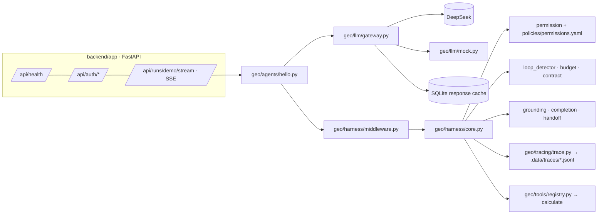

# Kiến trúc VietCite Studio

> **Cập nhật:** 24/10/2026 (Phase 1: nền móng kỹ thuật). Kế hoạch tổng thể: [KE_HOACH_DO_AN.md](KE_HOACH_DO_AN.md) mục 4.

Phase 1 dựng phần nền chung mà mọi use case dùng lại: gateway LLM, harness, tracing, provider, API web và khung frontend. Agent duy nhất hiện có là **agent hello** (một tool máy tính), dùng để chứng minh toàn bộ đường đi chạy được với cả mock lẫn DeepSeek thật.

## 1. Sơ đồ module (backend)



| Thư mục | Vai trò | Lớp harness |
|---|---|---|
| `geo/config.py` | Đọc `.env`, cờ tính năng, chọn model theo vai trò, bảng giá ước tính | |
| `geo/llm/` | `gateway` (timeout, retry, rate limit, cache), `usage` (token, prompt-cache hit, chi phí), `cache` (response cache SQLite), `mock` | context, logging |
| `geo/context/prompt_layout.py` | Prompt tĩnh ở đầu, dữ liệu của run ở cuối; chặn timestamp/id trong phần tĩnh | context (B7) |
| `geo/harness/` | `core` (checklist), `middleware` (cắm vào `create_agent`), `permission`, `loop_detector`, `budget`, `contract`, `grounding`, `completion`, `handoff` | permission, verification, handoff |
| `geo/tools/` | `registry` (allowlist, schema, envelope), `calculator` | tools |
| `geo/skills/catalog.py` | Quét `skills/*/SKILL.md`, chỉ đưa metadata vào prompt | skills |
| `geo/providers/` | `jina` (embed, rerank, reader, search, mock), `gemini_probe` (Google Search grounding) | retrieval |
| `geo/tracing/` | `trace` (JSONL theo run/span, che secret, tìm bước hỏng đầu tiên), `audit` (log chuỗi hash) | logging |
| `geo/policies/permissions.yaml` | Chính sách quyền dạng dữ liệu | permission |
| `app/` | FastAPI: health, đăng nhập JWT 2 vai trò, SSE demo | human approval (khung) |
| `cli.py` | `geo hello`, `geo trace`, `geo smoke` | |

## 2. Checklist của harness (thứ tự từ Buổi 3)

| # | Khi nào | Kiểm gì | Dừng với |
|---|---|---|---|
| 0 | Trước khi tool chạy | Schema tham số, allowlist của agent, luật deny/ask | chặn (`gate`) hoặc `NEEDS_HUMAN` |
| 1 | Sau observation | Tiêu chí hoàn thành bằng code | `GOAL` |
| 2 | | Lặp (tool, args) hoặc lặp lỗi | `LOOP` |
| 3 | | Tiến triển đứng yên | `STALL` |
| 4 | | Số lần gọi model, token, thời gian, tiền (**kiểm cuối**) | `BUDGET` |
| + | Model thôi gọi tool | Mọi con số trong câu trả lời phải có nguồn; tiêu chí hoàn thành | `GOAL` / `UNGROUNDED` / `UNVERIFIED` |

Mọi lần dừng khác `GOAL` sinh **gói bàn giao 4 trường**: lý do, đã thử gì, trạng thái, một câu hỏi cụ thể.

## 3. Hai loại cache (Buổi 7)

| | Response cache (của mình) | Prompt cache (của DeepSeek) |
|---|---|---|
| Nằm ở | `backend/.data/llm_cache.sqlite` | Phía nhà cung cấp |
| Dùng lại | Toàn bộ câu trả lời khi request giống hệt | Phần tính toán của prefix trùng |
| Chi phí khi trúng | 0, không gọi API | Rẻ hơn, token vẫn nằm trong context |
| Đếm ở | `usage.response_cache_hits` | `usage.cached_tokens`, `cache_hit_rate` |
| Mục đích | Eval tái lập, CI không tốn tiền | Giảm chi phí khi chạy thật |

Khoá của response cache được **chuẩn hoá**: bỏ id message, metadata phản hồi, đổi id tool call thành số thứ tự. Thiếu bước này thì agent nhiều lượt không bao giờ trúng cache từ lượt thứ hai.

## 4. API

| Method | Đường dẫn | Auth | Trả về |
|---|---|---|---|
| GET | `/api/health` | không | `{status, version, features{deepseek,jina,gemini}, offline}` (chỉ cờ, không có key) |
| POST | `/api/auth/login` | không | `{access_token, token_type, user{username, role}}`; 401 sai mật khẩu; 503 chưa cấu hình tài khoản |
| GET | `/api/auth/me` | Bearer | `{username, role}` |
| GET | `/api/runs/demo/stream?mode=mock\|live&question=` | Bearer | SSE: `trace` (mỗi bước), `done` (`run_id, stop_reason, answer, usage, trace_file`), `error`; 400 nếu `live` mà thiếu key |

Bảo mật: CORS chỉ `localhost:5173`, header `nosniff`/`DENY`/`no-referrer`, mật khẩu PBKDF2-SHA256, khoá tên đăng nhập 5 phút sau 5 lần sai, trace và audit tự che giá trị bí mật.

## 5. Biến môi trường mới ở Phase 1

| Biến | Ý nghĩa |
|---|---|
| `SEED_EDITOR_USERNAME` / `SEED_EDITOR_PASSWORD` | Tài khoản vai trò Editor (để trống mật khẩu thì không tạo) |
| `SEED_APPROVER_USERNAME` / `SEED_APPROVER_PASSWORD` | Tài khoản vai trò Approver |
| `JWT_SECRET` | Ký token. Trống thì sinh ngẫu nhiên mỗi lần chạy (token mất khi restart) |
| `GEMINI_MODEL` | Model cho probe Gemini (mặc định `gemini-2.5-flash`) |
| `WP_DB_PASSWORD` / `WP_DB_ROOT_PASSWORD` | Mật khẩu MariaDB cho WordPress trong docker compose |
| `GEO_DATA_DIR` | Nơi lưu cache, trace (mặc định `backend/.data`) |
| `GEO_PRICE_<MODEL>` | Ghi đè bảng giá ước tính, dạng `input,output,cached_input` (USD / 1M token) |

> ⚠️ Bảng giá DeepSeek trong `geo/config.py` là **giả định** để ước tính chi phí. Đối chiếu trang giá của nhà cung cấp trước khi đưa số liệu chi phí vào báo cáo.

## 6. Chạy và kiểm tra

```bash
make install          # uv sync + npm install (cần packages/cnma-react-ui-1.1.4.tgz)
make test             # backend pytest offline + frontend vitest
make lint typecheck   # ruff, pyright, tsc
make hello            # agent hello trên mock;  make hello MODE=live  → DeepSeek
make smoke            # gọi thật từng provider một lần (bỏ qua provider thiếu key)
make api   # và trong terminal khác:  make web   → http://localhost:5173
make up               # docker: WordPress :8080, API :8000, web :5173 (cần Docker Desktop)
```

Trace của mỗi run nằm ở `backend/.data/traces/<run_id>.jsonl`; `uv run geo trace <file> --locate` in bước hỏng đầu tiên.
