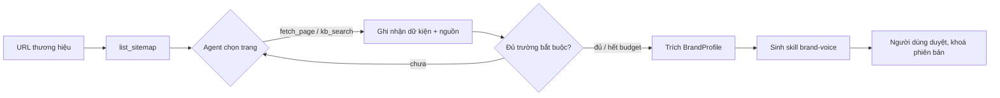

# UC1: Phân tích thương hiệu và sinh Brand-Voice Skill

> **Ưu tiên:** P0 · **Phụ trách:** TV3 · **Phase:** 3 · **Trạng thái:** Chưa bắt đầu

## 1. Mục tiêu, input, output

- **Mục tiêu:** hiểu thương hiệu đủ để mọi bài viết sau đúng sự thật và đúng giọng văn.
- **Input:** URL website (hoặc thư mục tài liệu), tên thương hiệu, danh sách đối thủ (nếu có).
- **Output:**
  - `BrandProfile` (Pydantic): tên chuẩn và alias, sản phẩm, USP, đối tượng, giọng văn (mức trang trọng, xưng hô, câu mẫu), từ cấm, từ bắt buộc, đối thủ, nguồn chính thức.
  - Skill `skills/brand-voice-<brand>/` (`SKILL.md`, `references/voice-guide.md`, `examples/`, `scripts/check_voice.py`).
  - Bản ghi trong brand memory có phiên bản.

## 2. Phân loại

| Câu hỏi               | Trả lời                                                                         |
| ----------------------- | --------------------------------------------------------------------------------- |
| Ai quyết bước tiếp? | **Model**: agent tự chọn trang cần đọc                                 |
| Ai giữ state?          | Hệ thống: state của agent, brand memory có phiên bản                        |
| Ai dừng?               | Code: đủ trường bắt buộc có nguồn, hoặc hết budget, hoặc loop detector |

**Kết luận:** agent (ReAct + structured output).

## 3. Sơ đồ luồng

## 4. Chức năng (0,5đ)

- [ ] Profile hợp lệ schema 100%.
- [ ] Mỗi khẳng định trong profile có URL nguồn.
- [ ] Skill sinh ra pass kiểm tra của skill catalog; `check_voice.py` chạy được.
- [ ] Người dùng sửa và khoá profile trên Brand Studio.

- **Lệnh demo:** *(bổ sung khi có code)*

## 5. Thiết kế harness (0,5đ)

| Lớp           | Dùng thế nào                                                                                | Vì sao                                               | File                                            |
| -------------- | ---------------------------------------------------------------------------------------------- | ----------------------------------------------------- | ----------------------------------------------- |
| tools          | `list_sitemap`, `fetch_page`, `kb_search`, envelope `{status,data,error,hint}`         | Agent chỉ đọc, không ghi                          | `geo/tools/`                                  |
| verification   | Completion bằng code: đủ trường, mỗi trường có nguồn                                 | Không tin model tự nói "xong"                      | `geo/harness/completion.py`                   |
| budget / loop  | ≤ 15 trang, giới hạn token; chặn fetch trùng URL                                          | Chống lặp, chống tốn tiền                        | `geo/harness/budget.py`, `loop_detector.py` |
| skills         | Sinh `brand-voice-<brand>` theo chuẩn Buổi 4                                               | Dùng lại cho Writer, Editor                         | `skills/`, `geo/skills/catalog.py`          |
| memory         | Brand memory có phiên bản; fact lỗi thời đánh `superseded`; `INDEX.md` + topic file | Quy ước thương hiệu bền qua nhiều session (B7) | `geo/memory/brand_memory.py`                  |
| human approval | Người dùng duyệt profile trước khi khoá                                                 | Profile sai thì mọi bài sau sai                    | Brand Studio                                    |

## 6. Kiểm chứng (0,5đ)

- **Dataset D1:** profile vàng cho 3 thương hiệu (Tallyo, Lâm Viên Coffee, một đối thủ thật chỉ phân tích từ trang công khai).
- **Dataset D10 (một phần):** kịch bản memory qua nhiều session (giá đổi thì run sau dùng giá mới).
- **Metric và ngưỡng:** F1 theo trường ≥ 0,8 · độ phủ nguồn 100% · trigger test của skill (kích hoạt đúng, không kích hoạt nhầm).
- **Kết quả thực đo:** *(chưa có)*
- **Trace mẫu:** chuỗi fetch và lý do chọn trang. *(chưa có)*
- **Ca thất bại (debug 4 bước):** *(chưa có)*

## 7. Kiến thức phủ

K1 ● · K2 ○ · K3 ○ · K4 ● · K5 ○ · K6 ● · K7 ○ · K8 ○
