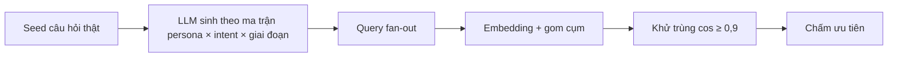

# UC2: Bản đồ câu hỏi người dùng hỏi AI (Query Universe)

> **Ưu tiên:** P1 · **Phụ trách:** TV3 / TV5 · **Phase:** 3 · **Trạng thái:** Chưa bắt đầu

## 1. Mục tiêu, input, output
- **Mục tiêu:** biết khách hàng hỏi AI những câu gì, để viết đúng câu cần được trích dẫn.
- **Input:** BrandProfile, chủ đề, persona (chủ tạp hoá chuyển từ thuế khoán sang kê khai, chủ shop bán đa kênh, chủ quán cà phê cần hoá đơn từ máy tính tiền, kế toán dịch vụ…).
- **Output:** `QueryUniverse` gồm 100–200 câu hỏi tiếng Việt, mỗi câu có `intent` (informational / comparative / navigational / transactional), `persona`, `funnel_stage`, `cluster_id`, `priority`; kèm "khoảng trống visibility" từ baseline của UC7.

## 2. Phân loại
| Câu hỏi | Trả lời |
|---|---|
| Ai quyết bước tiếp? | **Code**: các bước cố định |
| Ai giữ state? | Hệ thống |
| Ai dừng? | Code: hết bước |

**Kết luận:** workflow (chain + clustering). Không cần agent vì các bước định sẵn được.

## 3. Sơ đồ luồng

## 4. Chức năng (0,5đ)
- [ ] Mỗi câu có đủ nhãn.
- [ ] Tỷ lệ trùng ≤ 5%.
- [ ] Không quá 60% câu thuộc một loại intent.
- **Lệnh demo:** *(bổ sung khi có code)*

## 5. Thiết kế harness (0,5đ)
| Lớp | Dùng thế nào | Vì sao | File |
|---|---|---|---|
| context / skills | Prompt template có version | Tái lập được, so sánh được giữa các phiên bản | `geo/agents/query_strategist.py` |
| verification | Structured output; dedup bằng code | Không để LLM tự khử trùng | *(bổ sung)* |
| budget | Giới hạn số lượt sinh và token | Kiểm soát chi phí | `geo/harness/budget.py` |

## 6. Kiểm chứng (0,5đ)
- **Dataset D2:** 60 câu hỏi thật thu từ diễn đàn, hội nhóm kinh doanh và kế toán, người quen làm hộ kinh doanh.
- **Metric và ngưỡng:** semantic recall ≥ 0,7 (câu vàng có câu sinh tương đương, cos ≥ 0,8) · duplicate rate ≤ 5% · số cụm (độ đa dạng).
- **Kết quả thực đo:** *(chưa có)*
- **Trace mẫu:** *(chưa có)*
- **Ca thất bại (debug 4 bước):** *(chưa có)*

## 7. Kiến thức phủ
K1 ● · K3 ○ · K4 ○ · K5 ○ · K7 ●
