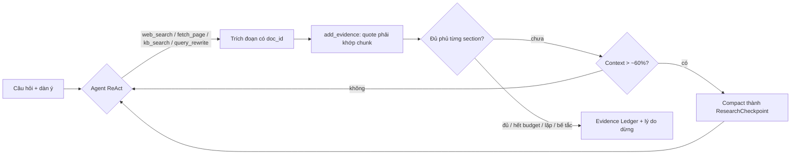

# UC3: Nghiên cứu nguồn và Evidence Ledger (Agentic RAG)

> **Ưu tiên:** P0 · **Phụ trách:** TV2 · **Phase:** 2 (kho tri thức), 4 (agent) · **Trạng thái:** Chưa bắt đầu

## 1. Mục tiêu, input, output
- **Mục tiêu:** thu đủ bằng chứng trước khi viết, để mọi con số trong bài truy được về nguồn.
- **Input:** câu hỏi mục tiêu, dàn ý, BrandProfile.
- **Output:** **Evidence Ledger**: danh sách `Evidence{id, claim, quote nguyên văn, url, chunk_id, published_at, valid_year, trust_tier}` (trust_tier: chính thức / báo chí / diễn đàn), kèm báo cáo độ phủ theo từng section.

## 2. Phân loại
| Câu hỏi | Trả lời |
|---|---|
| Ai quyết bước tiếp? | **Model**: agent tự chọn search, đọc trang hay tra kho |
| Ai giữ state? | Hệ thống: ledger trong state; `ResearchCheckpoint` khi compact |
| Ai dừng? | Code: tiêu chí phủ, budget, loop detector, stall detector |

**Kết luận:** agent (ReAct + termination bằng code).

## 3. Sơ đồ luồng

## 4. Chức năng (0,5đ)
- [ ] Ledger đạt tiêu chí phủ: mỗi section ≥ 2 evidence; mỗi số liệu có ≥ 1 nguồn "chính thức" hoặc ≥ 2 nguồn độc lập.
- [ ] Không có evidence nào có quote bịa.
- [ ] Dừng đúng một trong 5 kiểu dừng và ghi log lý do.
- **Lệnh demo:** *(bổ sung khi có code)*

## 5. Thiết kế harness (0,5đ)
| Lớp | Dùng thế nào | Vì sao | File |
|---|---|---|---|
| retrieval | Hybrid BM25 (underthesea) + vector Jina, RRF k=60, Jina rerank | Embedding yếu với số hiệu văn bản, BM25 bù lại | `geo/knowledge/` |
| verification | Completion bằng code; grounding: quote phải tồn tại trong chunk | Không tin model tự tuyên bố | `geo/harness/completion.py`, `grounding.py` |
| termination | Budget, LoopDetector, stall detector | Đủ 5 điều kiện dừng của B3 | `geo/harness/` |
| context | Trang đầy đủ ở snapshot, agent chỉ nhận trích đoạn; `ResearchCheckpoint` (KEEP ràng buộc, evidence_ids, query thất bại) | Chống tool-output bloat (B7) | `geo/context/checkpoint.py` |
| permission | Researcher không có tool ghi hay publish; nội dung web bọc `<untrusted_source>`, lọc injection | Least privilege, chống prompt injection | `geo/security/` |
| tools | Envelope `ok` khác `error` kèm `hint` | Tránh "tin dữ liệu sai" | `geo/tools/` |
| *(P1)* Code Mode | `run_analysis` trong Docker `--network none` để quét nhiều trang bảng giá | Giảm token khi đọc nhiều trang | `geo/codemode/` |

## 6. Kiểm chứng (0,5đ)
- **Dataset D3:** golden RAG 30 câu (1/3 khái niệm, 1/3 định danh, 1/3 bẫy) + 5 câu không có đáp án.
- **Dataset D8:** 15 trang chứa prompt injection.
- **Bảng so sánh cấu hình:** A (vector, chunk 500) / B (heading + metadata) / C (B + BM25, RRF) / D (C + rerank). Cột: Recall@5, Recall@20, MRR, Precision@5, Faithfulness, Citation Existence, Abstention, latency p50. Thêm ablation tách từ tiếng Việt.
- **Context (B7):** input token và độ phủ evidence của 3 cấu hình: không quản lý context / archive + compaction / thêm Code Mode (nếu làm).
- **Ngưỡng:** Recall@5 ≥ 0,85 · Citation Existence 100% · Abstention ≥ 0,8 · ASR injection ≤ 5%.
- **Kết quả thực đo:** *(chưa có)*
- **Trace mẫu:** *(chưa có, cần đủ 5 kiểu dừng)*
- **Ca thất bại (debug 4 bước):** *(chưa có; ứng viên: truy vấn số hiệu văn bản bị vector search tụt hạng)*

## 7. Kiến thức phủ
K1 ○ · K2 ● · K3 ● · K4 ● · K5 ● · K6 ● · K7 ● · K8 ●
