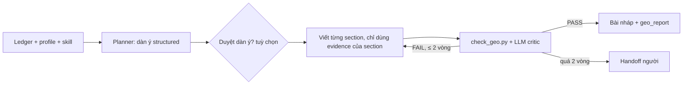

# UC4: Viết bài GEO theo giọng thương hiệu

> **Ưu tiên:** P0 · **Phụ trách:** TV3 · **Phase:** 4 · **Trạng thái:** Chưa bắt đầu

## 1. Mục tiêu, input, output
- **Mục tiêu:** bài tiếng Việt trả lời thẳng câu hỏi người dùng hỏi AI, đúng giọng thương hiệu, mọi số liệu có nguồn.
- **Input:** câu hỏi mục tiêu và cụm câu con (UC2), Evidence Ledger (UC3), BrandProfile, skill `geo-writing` và `brand-voice-<brand>`.
- **Output:** bài Markdown có marker trích dẫn `[E12]`, các phiên bản nháp, `geo_report`.

## 2. Phân loại
| Câu hỏi | Trả lời |
|---|---|
| Ai quyết bước tiếp? | **Lai**: code định khung plan → viết → critic; model quyết nội dung dàn ý và cách sửa |
| Ai giữ state? | Hệ thống: dàn ý, các phiên bản nháp trong state |
| Ai dừng? | Code: `check_geo.py` PASS hoặc hết 2 vòng sửa |

**Kết luận:** lai (plan-then-execute + reflection có trần vòng).

## 3. Sơ đồ luồng

## 4. Chức năng (0,5đ)
- [ ] `check_geo.py` PASS ≥ 90% mục.
- [ ] 100% câu chứa số liệu có marker evidence.
- [ ] Giọng văn đúng profile (xưng hô, từ cấm, độ dài).
- **Lệnh demo:** *(bổ sung khi có code)*

## 5. Thiết kế harness (0,5đ)
| Lớp | Dùng thế nào | Vì sao | File |
|---|---|---|---|
| skills | `geo-writing` (luật GEO, `scripts/check_geo.py`), `brand-voice-<brand>`; progressive disclosure | Nhất quán giữa các lần viết | `skills/` |
| verification | `check_geo.py` (computational) + LLM critic (inferential) | Ưu tiên sensor tất định | `skills/geo-writing/scripts/` |
| workflow | Plan có thể duyệt; reflection tối đa 2 vòng | Tránh sửa vô hạn | `geo/agents/writer.py` |
| memory / context | Editorial lessons nạp theo index, ghi span `memory_injected` | Không lặp lỗi người duyệt đã sửa (B7) | `geo/memory/editorial_lessons.py` |
| constraints | Độ dài, xưng hô, từ cấm là dữ liệu, không viết cứng trong prompt | Đổi thương hiệu không phải sửa code | BrandProfile |

## 6. Kiểm chứng (0,5đ)
- **Dataset D6:** 30 đoạn văn do người chấm on-voice / off-voice, dùng để hiệu chuẩn LLM judge (Cohen's κ ≥ 0,6). Judge là Gemini (khác họ với writer DeepSeek).
- **A/B:** writer có skill so với không có skill: điểm GEO checklist, điểm giọng văn, token, số vòng sửa.
- **Kết quả thực đo:** *(chưa có)*
- **Trace mẫu:** dàn ý, các vòng critic và lý do sửa. *(chưa có)*
- **Ca thất bại (debug 4 bước):** *(chưa có)*

## 7. Kiến thức phủ
K1 ● · K2 ● · K3 ● · K4 ● · K5 ○ · K6 ● · K7 ●
