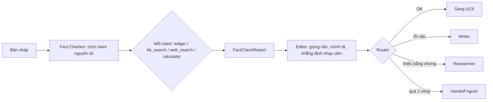

# UC5: Kiểm chứng số liệu và biên tập (multi-agent)

> **Ưu tiên:** P0 · **Phụ trách:** TV4 · **Phase:** 5 · **Trạng thái:** Chưa bắt đầu

## 1. Mục tiêu, input, output
- **Mục tiêu:** hệ thống chứng minh bài đúng, thay vì agent tự nói bài đúng.
- **Input:** bản nháp, Evidence Ledger, BrandProfile.
- **Output:**
  - `FactCheckReport`: danh sách `ClaimVerdict{claim, type, verdict ∈ supported / contradicted / outdated / unverifiable, evidence_ids, fix_suggestion}`.
  - `EditorReport`.
  - Quyết định của router.

## 2. Phân loại
| Câu hỏi | Trả lời |
|---|---|
| Ai quyết bước tiếp? | Fact-Checker: **model** chọn cách kiểm từng claim. Router: model chọn trong **tập nhánh hữu hạn** do code định |
| Ai giữ state? | Hệ thống: report, số vòng sửa trong state |
| Ai dừng? | Code: hết claim chưa xử lý, hoặc quá 2 vòng thì handoff người |

**Kết luận:** agent (Fact-Checker) + workflow định tuyến.

## 3. Sơ đồ luồng

## 4. Chức năng (0,5đ)
- [ ] Bài sau UC5 không còn claim `contradicted` hay `unverifiable` chưa xử lý.
- [ ] Vòng sửa hội tụ trong ≤ 2 vòng, hoặc bàn giao người kèm câu hỏi cụ thể.
- **Lệnh demo:** *(bổ sung khi có code)*

## 5. Thiết kế harness (0,5đ)
| Lớp | Dùng thế nào | Vì sao | File |
|---|---|---|---|
| verification | Numeric grounding: mọi số, ngày, số hiệu văn bản, giá, tên riêng phải map tới evidence | Bắt bịa số bằng code | `geo/harness/grounding.py` |
| workflow | Router chỉ chọn trong {OK, sửa văn, thiếu bằng chứng, handoff}; trần 2 vòng | Không để vòng sửa chạy mãi | `geo/graph/pipeline.py` |
| handoff | Gói 4 trường: lý do dừng, đã thử, trạng thái, câu hỏi cụ thể | Người nhận trả lời được trong 30 giây | `geo/harness/handoff.py` |
| tools / permission | Allowlist riêng cho từng agent; `calculator` để tính lại phần trăm | Việc chính xác giao cho code | `geo/tools/registry.py` |
| context | Compact khi kiểm nhiều claim; *(P1)* dùng code lọc claim có số trước | Giảm token (B7) | `geo/context/` |

## 6. Kiểm chứng (0,5đ)
- **Dataset D4:** 20 đoạn bài đúng + 60 lỗi tiêm có chủ đích (sai số, sai năm hoặc lỗi thời, sai thực thể, trích dẫn bịa, so sánh nhất vô căn cứ, tính toán sai) + 20 đoạn sạch làm đối chứng.
- **Metric và ngưỡng:** recall theo loại lỗi ≥ 0,85 · precision ≥ 0,8 · false alarm trên đoạn sạch ≤ 10% · confusion matrix theo loại.
- **Kết quả thực đo:** *(chưa có)*
- **Trace mẫu:** *(chưa có)*
- **Ca thất bại (debug 4 bước):** phân tích một lỗi bị bỏ sót. *(chưa có)*

## 7. Kiến thức phủ
K1 ○ · K2 ● · K3 ● · K4 ○ · K5 ● · K6 ○ · K7 ● · K8 ●
