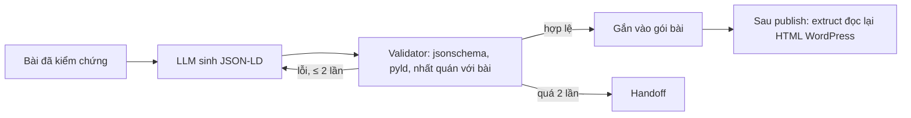

# UC6: Schema markup và GEO kỹ thuật

> **Ưu tiên:** P1 · **Phụ trách:** TV4 · **Phase:** 5 · **Trạng thái:** Chưa bắt đầu

## 1. Mục tiêu, input, output
- **Mục tiêu:** bài có dữ liệu cấu trúc đúng chuẩn để máy (công cụ tìm kiếm, AI) đọc được chính xác.
- **Input:** bài đã qua UC5, BrandProfile, URL dự kiến.
- **Output:** JSON-LD `@graph` (`Article`/`BlogPosting`, `FAQPage`, `Organization`, `SoftwareApplication` kèm `Offer`, `HowTo` cho bài hướng dẫn, `BreadcrumbList`), meta title và description, `llms.txt` cho site.

## 2. Phân loại
| Câu hỏi | Trả lời |
|---|---|
| Ai quyết bước tiếp? | **Code**: sinh → validate → sửa |
| Ai giữ state? | Hệ thống |
| Ai dừng? | Code: hợp lệ, hoặc hết 2 lần sửa thì handoff |

**Kết luận:** workflow + sensor computational.

## 3. Sơ đồ luồng

## 4. Chức năng (0,5đ)
- [ ] JSON-LD hợp lệ theo schema của nhóm.
- [ ] Câu FAQ khớp H2, ngày và tác giả khớp với bài.
- [ ] Sau publish, đọc lại trang thấy JSON-LD thật sự có mặt.
- **Lệnh demo:** *(bổ sung khi có code)*

## 5. Thiết kế harness (0,5đ)
| Lớp | Dùng thế nào | Vì sao | File |
|---|---|---|---|
| verification | `jsonschema`, `pyld`, kiểm nhất quán với bài; đọc lại bằng `extruct` | Sensor tất định, kiểm chứng chéo "đọc lại" (B3) | `geo/tools/schema_validate.py` |
| workflow | Trần 2 lần sửa rồi handoff | Không lặp vô hạn | `geo/agents/schema_engineer.py` |
| skills | Skill `schema-markup` có script kiểm tra | Bước cuối luôn là kiểm tra (B4) | `skills/schema-markup/` |

## 6. Kiểm chứng (0,5đ)
- **Dataset D5:** 15 bài với tập type và thuộc tính kỳ vọng.
- **Metric và ngưỡng:** hợp lệ 100% · đủ thuộc tính bắt buộc 100% · nhất quán 100% · số vòng sửa trung bình.
- **Kết quả thực đo:** *(chưa có)*
- **Trace mẫu:** *(chưa có)*
- **Ca thất bại (debug 4 bước):** *(chưa có)*

## 7. Kiến thức phủ
K1 ● · K3 ● · K4 ● · K7 ●
